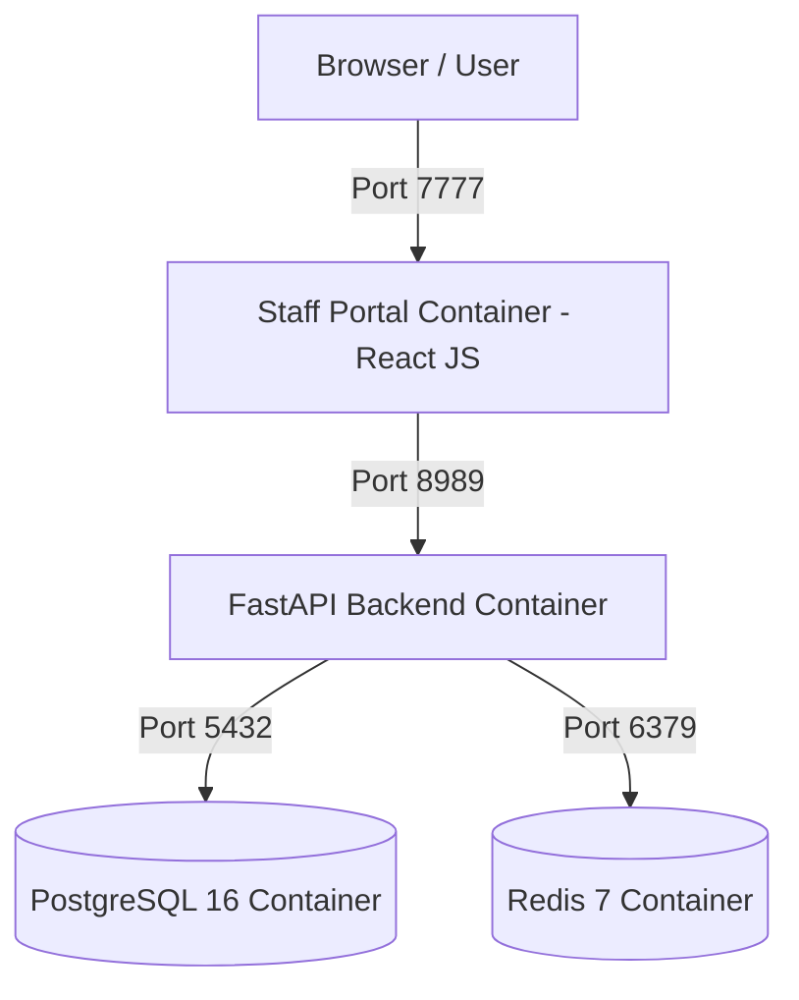

# 🪟 Windows 11 Setup Guide: Installing Docker & Nexora Platform

This document is the official step-by-step installation guide for team members running **Windows 11**. It covers installing **Docker Desktop** from scratch and deploying the complete **Nexora Platform** (PostgreSQL, Redis, FastAPI Backend API, and Staff Portal) using **Docker Compose**.

---

## 🏗️ System Architecture

The entire Nexora system runs containerized inside Docker Desktop:



| Container | Image / Tech | Port | Description |
|---|---|---|---|
| `arc8-frontend` | React 18 / Nginx | `7777` | Staff Portal UI (Operational dashboards, coding workbench) |
| `arc8-backend` | Python 3.11 / FastAPI | `8989` | Core Control Plane & Multi-tenant API (Auto-seeds DB on startup) |
| `arc8-postgres` | PostgreSQL 16 Alpine | `5432` | Multi-tenant database engine (`nexora_control`, `prominence_tenant`) |
| `arc8-redis` | Redis 7 Alpine | `6379` | Rate-limiting cache & background queue engine |

---

## 📋 System Requirements

Before starting, ensure your PC meets these requirements:

- **Operating System**: Windows 11 64-bit (Home, Pro, Enterprise, or Education).
- **RAM**: Minimum 8 GB (16 GB recommended).
- **Hardware Virtualization**: Enabled in BIOS/UEFI (enabled by default on Windows 11 PCs).

---

## Step 1: Install WSL 2 (Windows Subsystem for Linux)

Docker Desktop on Windows 11 requires **WSL 2** for optimal performance.

1. Open **PowerShell as Administrator** (Right-click Start button -> **Terminal (Admin)** or **Windows PowerShell (Admin)**).
2. Run the following command:
   ```powershell
   wsl --install
   ```
3. Update WSL to the latest version:
   ```powershell
   wsl --update
   ```
4. **Restart your Windows 11 PC** if prompted by Windows.

---

## Step 2: Install Docker Desktop on Windows 11

1. Download the official Docker Desktop installer:
   👉 **[Download Docker Desktop for Windows](https://desktop.docker.com/win/main/amd64/Docker%20Desktop%20Installer.exe)**

2. Double-click **`Docker Desktop Installer.exe`** to launch setup.
3. On the configuration screen, make sure **"Use WSL 2 instead of Hyper-V"** is checked.
4. Click **OK** and wait for the installation to finish (2–4 minutes).
5. Click **Close and Restart**.

---

## Step 3: Launch & Verify Docker Desktop

1. Open **Docker Desktop** from the Windows 11 Start menu.
2. Accept the Docker Subscription Service Agreement.
3. Wait for Docker Desktop to finish booting until the icon in the bottom-left corner turns **Green** (*"Engine running"*).
4. Verify Docker in **PowerShell**:
   ```powershell
   docker --version
   docker compose version
   ```
5. Test Docker with a quick verification command:
   ```powershell
   docker run hello-world
   ```
   *If you see "Hello from Docker!", your Docker Desktop environment is ready!*

---

## Step 4: Install Git for Windows

If Git is not already installed on your system:
1. Download from [git-scm.com/download/win](https://git-scm.com/download/win).
2. Run the installer and accept all default options.

---

## Step 5: Clone & Deploy Nexora via Docker Compose

### 5.1 Clone the Repository
Open **PowerShell** or **Git Bash** and run:
```powershell
git clone https://github.com/fazlioeight/nexora-platform.git
cd nexora-platform
```

### 5.2 Build & Start All Containers
Run Docker Compose from the root `nexora-platform` directory:
```powershell
docker compose up --build -d
```

### 5.3 Verify Container Status
Check that all 4 containers are running:
```powershell
docker compose ps
```
You should see:
- `arc8-postgres` (Status: `Up` / `healthy`)
- `arc8-redis` (Status: `Up` / `healthy`)
- `arc8-backend` (Status: `Up`)
- `arc8-frontend` (Status: `Up`)

> ℹ️ **Automatic Database Seeding**: The `arc8-backend` container automatically initializes PostgreSQL, creates required control & tenant databases (`nexora_control`, `prominence_tenant`), runs database schema migrations, and provisions the default administrator account (`admin@prominencehealth.com`).

---

## Step 6: Access URLs & Default Credentials

Once Docker containers are running, open your web browser to access the system:

### 1. Nexora Staff Portal
- **URL**: `http://localhost:7777`
- **Default Admin Email**: `admin@prominencehealth.com`
- **Default Password**: `admin`
- **Quick Demo Login**: Click the **"Dummy Login"** button on the login screen to sign in as `admin@admin.com`.

### 2. Backend API Documentation (Swagger)
- **URL**: `http://localhost:8989/docs`
- **ReDoc URL**: `http://localhost:8989/redoc`

---

## Step 7: Docker Management Commands

Here are common Docker commands for everyday development on Windows 11:

- **View Live System Logs**:
  ```powershell
  docker compose logs -f
  ```

- **View Backend API Logs Only**:
  ```powershell
  docker compose logs -f backend
  ```

- **Stop All Containers**:
  ```powershell
  docker compose down
  ```

- **Restart a Specific Service (e.g., Backend)**:
  ```powershell
  docker compose restart backend
  ```

- **Complete Reset (Wipe Databases & Start Fresh)**:
  ```powershell
  docker compose down -v
  docker compose up --build -d
  ```

---

## 🛠️ Windows 11 Troubleshooting & FAQs

### Q1: Docker Desktop shows "WSL 2 installation is incomplete"
**Solution**: Open PowerShell as Administrator and run:
```powershell
wsl --update
wsl --shutdown
```
Then restart Docker Desktop.

### Q2: Port 5432, 6379, 8989, or 7777 is already in use on Windows
**Solution**: Find and terminate the process holding the port in PowerShell:
```powershell
Get-NetTCPConnection -LocalPort 8989 | Select-Object OwningProcess
Stop-Process -Id <PROCESS_ID> -Force
```

### Q3: Script execution or bash line ending error (`\r: command not found`)
**Solution**: Windows Git sometimes converts shell scripts to CRLF (`\r\n`). Configure Git to keep LF line endings:
```powershell
git config --global core.autocrlf false
```
Then re-clone the repository.
