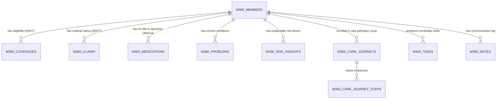

# ADR-001: Target AWS Architecture, Auth Standardization & Member 360 Data Model

**Project:** Arc8 MVP — Prominence Health First Inc.  
**Deliverables:** Sprint 0 Architecture Decision Record (`SP0-ADR` / `M2`) & MVP Data Model Walkthrough (`#4889`)  
**Authors:** Syed Sana Ul Haq Fazli (Architecture & Full-Stack Lead), Shaheer Sarwar (Sr. DevOps Lead), Ramesh B (Data Architecture Lead)  
**Approved By:** Wayne White (Project Lead)  
**Date:** October 15, 2026  
**Status:** Accepted  

---

## 1. Context & Problem Statement

The inherited `Nexora Lab` prototype is a multi-product monorepo originally built and deployed against Microsoft Azure (`infra/azure`, Azure Static Web Apps, Azure Container Apps, Azure Key Vault, Azure Blob Storage, and Azure Entra ID). Additionally:
1. It contains **10 modules / 27 FastAPI routers** and **two separate React SPAs** (`frontend/` for internal staff and `frontend-member/` + `edge/member-portal/` for external members), whereas Prominence Health's target ecosystem uses **AaNeel** for external member/provider portals and positions **Arc-8** strictly as the internal **Member 360** care coordination and call center workspace.
2. Tenant-scoped tables (`m360_*`) are currently provisioned at runtime via `metadata.create_all` rather than formal Alembic migrations.

Per SOW No. 3, Arc-8 must be re-architected and deployed to a dedicated, HIPAA-eligible **AWS environment** managed via Infrastructure as Code (Terraform) and deployed exclusively through GitHub Actions using OIDC federation.

---

## 2. Architectural Decisions

### Decision 1: Azure-to-AWS Service Mapping
We will decouple all Azure-specific SDKs and infrastructure scripts and map the runtime stack to dedicated HIPAA-eligible AWS services:

| Architecture Layer | Legacy Prototype (Azure) | Target Arc-8 MVP (AWS) | Rationale |
| :--- | :--- | :--- | :--- |
| **Frontend Hosting & CDN** | Azure Static Web Apps + Front Door | **Amazon S3 + CloudFront + AWS WAF** | Low-cost, globally cached static SPA delivery with TLS 1.3 and OWASP WAF protection. |
| **Backend API Compute** | Azure Container Apps / Functions | **Amazon ECS Fargate** (behind ALB) | Runs the existing FastAPI + Gunicorn/Uvicorn Docker container with zero cold-start latency for Member 360 queries. |
| **Relational Database** | Azure Database for PostgreSQL / SQLite | **Amazon RDS for PostgreSQL 16** (Encrypted with AWS KMS) | Preserves 100% compatibility with SQLAlchemy asyncpg and the `nexora_control` + `prominence_tenant` multi-tenant model. |
| **Cache & Token Revocation** | Azure Cache for Redis | **Amazon ElastiCache for Redis 7** | Supports existing JWT `jti` blacklist revocation and rate-limiting middleware (`middleware/rate_limit.py`). |
| **Document / Object Storage** | Azure Blob Storage (`MEMBER360_STORAGE_BACKEND=azure`) | **Amazon S3** (SSE-KMS encrypted, private bucket) | Stores synthetic EOB PDFs and member attachments via pre-signed URLs. |
| **Identity & SSO** | Azure Entra ID / MSAL | **Amazon Cognito (OIDC)** | Standard OIDC/JWKS token verification ready to federate with Prominence's corporate IdP. |
| **Secrets Management** | Azure Key Vault | **AWS Secrets Manager & SSM Parameter Store** | Injects `SECRET_KEY`, `FIELD_ENCRYPTION_KEY`, and DB credentials into ECS tasks at runtime via IAM Task Roles. |
| **Audit & Observability** | Azure Monitor / Log Analytics | **Amazon CloudWatch Logs & AWS CloudTrail** | Captures tamper-evident HIPAA access logs (`tenant_audit_events`) with KMS encryption and retention policies. |
| **CI/CD & IaC** | PowerShell + Bicep | **Terraform + GitHub Actions (AWS OIDC)** | Zero long-lived AWS keys in GitHub; automated lint, pytest, jest, SAST, and SBOM gates on every PR. |

---

### Decision 2: Frontend Consolidation & Module Scoping
* **Decision:** For the Prominence MVP launch, only the **Staff Member 360 Workspace** (`frontend/src/pages/platform/member360-lab/`) and **Admin User/Role Management** are in scope.
* **Implementation:**
  1. `PORTAL_APPLICATIONS` configuration and React route guards will restrict visible navigation strictly to Member 360, Rising-Risk Worklists, Care Journeys, Tasks, and Admin Settings.
  2. The external `frontend-member/` and `edge/member-portal/` will not be deployed to AWS Dev/Test unless explicitly added via SOW change control (as **AaNeel** serves as Prominence's external member portal).
  3. Deep-link query parameters (`?memberId=<id>` and `?phone=<number>`) will be supported on the Member 360 route to enable 1-click screen-pop from **Talkdesk**.

---

### Decision 3: Member 360 Domain Data Model (`#4889` Walkthrough Alignment)
All `m360_*` tables in the tenant database (`prominence_tenant`) will be brought under formal **Alembic migrations** in Sprint 1 (replacing runtime `metadata.create_all`).

| Table Name | Primary Source System (Synthetic Mirror) | Key Columns & Purpose |
| :--- | :--- | :--- |
| **`m360_members`** | **QNXT** (Eligibility / Demographics) | `id`, `external_id`, `first_name`, `last_name`, `dob`, `phone`, `plan_name`, `pcp_name`, `risk_tier`, `risk_score` |
| **`m360_coverages`** | **QNXT** (Benefit & Plan Enrollment) | `member_id`, `payer`, `plan_type` (MA / MA-PD / D-SNP), `effective_start`, `effective_end`, `status` |
| **`m360_claims`** | **QNXT** (Medical & Acute Utilization) | `member_id`, `claim_number`, `service_date`, `claim_type` (`Inpatient`, `ER`, `Outpatient`), `diagnosis_codes`, `paid_amount`, `status` |
| **`m360_medications`** | **Abarca** (PBM / Pharmacy Fills) | `member_id`, `drug_name`, `ndc_code`, `fill_date`, `days_supply`, `adherence_pdc`, `status` (`Filled`, `Rejected`, `PA_Required`) |
| **`m360_problems`** | **QNXT / Jiva** (Clinical Conditions) | `member_id`, `icd10_code`, `description`, `clinical_status`, `onset_date`, `hcc_category` |
| **`m360_risk_insights`** | **Arc-8 Risk Engine** | `member_id`, `insight_type`, `severity`, `title`, `clinical_rationale` (explainable attribution factor) |
| **`m360_care_journeys`** | **Jiva / Arc-8 Orchestration** | `member_id`, `template_id`, `title`, `current_stage`, `assigned_coordinator`, `status` |
| **`m360_tasks`** | **Arc-8 Workflow & Escalations** | `member_id`, `title`, `priority`, `status`, `due_date`, `assigned_to`, `escalation_flag` (e.g., 48-hr post-discharge trigger) |
| **`m360_notes` / `m360_messages`** | **Arc-8 Communication Log** | `member_id`, `author_name`, `channel` (`Call`, `Note`, `Outreach`), `body`, `created_at` |
| **`tenant_audit_events`** | **Arc-8 HIPAA Security Middleware** | `id`, `tenant_key`, `actor_id`, `action` (`READ`, `WRITE`, `EXPORT`), `resource_type`, `resource_id`, `ip_address`, `created_at` |

---

## 3. Consequences & Next Steps
* **Positive:** Preserves 100% of the validated FastAPI clinical query logic and synthetic data seed scripts while eliminating Azure lock-in and runtime schema drift.
* **Action Items for Sprint 1 (Oct 19 – Oct 30):**
  1. **Shaheer (DevOps):** Execute Terraform modules for AWS Dev (`VPC`, `ECS`, `RDS`, `S3`, `CloudFront`, `Cognito`).
  2. **Ramesh (Data):** Generate initial Alembic migration for `m360_*` tables and expand synthetic dataset (`v1`) with QNXT/Abarca attributes.
  3. **Syed (Tech Lead):** Implement `STORAGE_BACKEND=s3`, Cognito OIDC token verification, and `PORTAL_APPLICATIONS` scoping.
