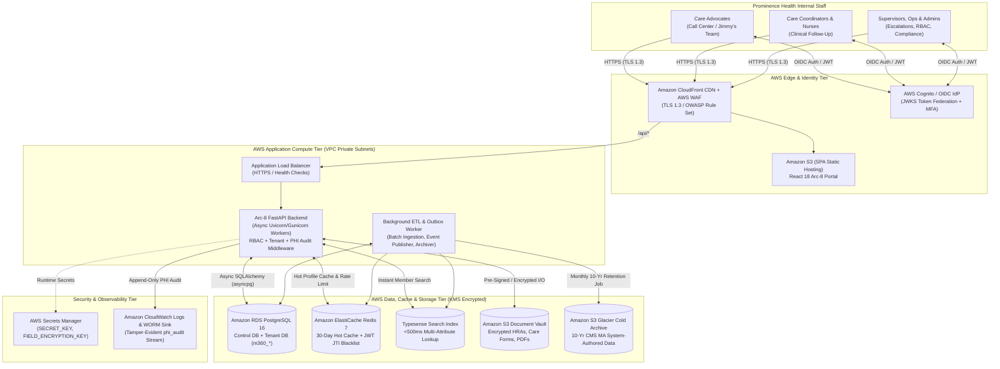
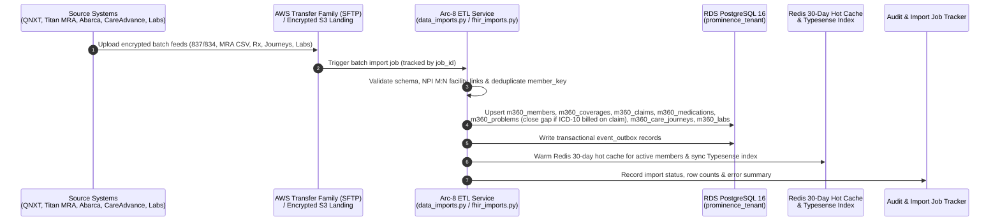
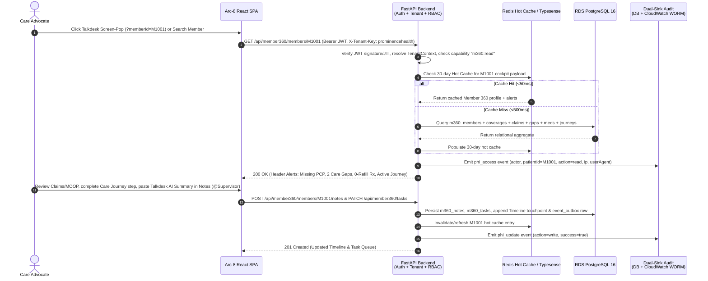
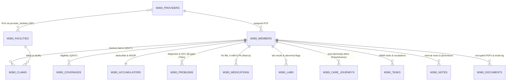

# Deliverable D2: Solution Design, Data Flows, Security Design & RTM v1.0

| Document Metadata | Details |
| :--- | :--- |
| **Project** | Arc-8 MVP — Prominence Health First Inc. (SOW No. 3) |
| **Deliverable ID** | **Deliverable D2** (`SP1-04`: Solution Design, Data Flows, Security Architecture & `RTM v1.0`) |
| **Submission Date** | October 23, 2026 |
| **Author / Owner** | Syed Sana Ul Haq Fazli (Architecture & Full-Stack Lead) |
| **Co-Authors & Reviewers** | Wayne White (Project Lead), Ramesh Muralasetty (Data Architecture Lead), Shaheer Sarwar (Sr. DevOps Lead), Shahzad Sultan (Sr. QA Engineer) |
| **Status** | **Submitted — Baseline v1.0** |
| **Inputs & References** | [D1 Baseline](./D1_ARCHITECTURE_DISCOVERY_AND_3R_ASSESSMENT.md), [ADR-001](./ADR-001-aws-target-architecture.md), [FRD v0.1](../FUNCTIONAL_REQUIREMENTS_DOCUMENT.md), [Client Walkthrough Workflow](./PROPOSED_SYSTEM_WORKFLOW_FROM_CLIENT_WALKTHROUGH.md) |

---

## 1. Solution Design Architecture

### 1.1 Architectural Vision & Business Alignment
**Arc-8 (Member 360)** is designed as Prominence Health's high-speed, HIPAA-compliant **Single Pane of Glass** for Care Advocates (~60,000 inbound claim-status calls/month), Care Coordinators/Nurses, and Operations Supervisors. It consolidates member data from six disconnected enterprise silos (**QNXT**, **Project Titan / MRA**, **Abarca PBM**, **CareAdvance**, **Clinical Labs**, and **Talkdesk**) into a unified sub-second workspace hosted on **AWS**.

### 1.2 Target AWS System Architecture Diagram



### 1.3 Component Design Breakdown

| Tier | Component | Codebase Implementation | Design Responsibilities |
| :--- | :--- | :--- | :--- |
| **Presentation (SPA)** | **Arc-8 Staff Portal** | `frontend/src/pages/platform/member360-lab/` | Role-gated navigation shell (`PortalPageLayout`), Care Intelligence NOC Dashboard, Instant Member Search, Member 360 Header & Alert Bar, and 8 consolidated clinical/operational tabs. Supports Talkdesk URL screen-pop (`?memberId=<id>`, `?search=<q>`). |
| **API Gateway & Middleware** | **FastAPI Middleware Pipeline** | `backend/app/main.py`, `app/middleware/*` | Enforces `SecurityHeadersMiddleware` (CSP, HSTS, X-Frame-Options), `RateLimitMiddleware` (Redis-backed sliding window), `TenantMiddleware` (`X-Tenant-Key` resolution), and `RequestLoggingMiddleware` (correlation IDs). |
| **Domain Services** | **Member 360 & Admin Services** | `backend/app/routes/member360.py`, `app/services/member360.py`, `app/services/member360_admin.py` | Orchestrates Member 360 profile aggregation, Claims & Accumulator progress bars (Deductible + combined Medical/Rx MOOP), Care Gaps & HCC `$` badges, Rx 0-refill/PA alerts, CareAdvance Care Journey stage transitions, SBAR tasks, supervisor escalation queues, and `@mention` internal notes. |
| **Data Persistence** | **Multi-Tenant PostgreSQL 16** | `backend/app/db/tenant_manager.py`, `app/models/member360.py` | Dual-database topology: `nexora_control` (tenants, users, roles, module licenses, `tenant_audit_events`) and isolated per-tenant database `prominence_tenant` (`m360_*` tables managed via Alembic migrations). |
| **Search & Caching** | **30-Day Hot Cache & Typesense** | `backend/app/core/redis.py`, `app/services/provider_search.py` | Caches members with activity in the last 30 days in Redis (`TTL=30d`, invalidated on write/ETL) and indexes member attributes in Typesense for `<500ms` lookup. |
| **Event & Outbox Layer** | **Transactional Outbox** | `backend/app/events/outbox.py`, `envelope.py`, `publisher.py` | Persists domain events (`CloudEvents` envelope) in the same database transaction as state mutations (`event_outbox`), guaranteeing at-least-once downstream delivery for timeline updates, notifications, and cache invalidation. |

### 1.4 Consolidated Member 360 UI & Tab Architecture
To eliminate horizontal tab scrolling and cognitive overload during live calls, the 15 legacy prototype tabs are consolidated into **8 role-gated operational tabs** plus **3 Supervisor/Admin tabs**, while out-of-scope tabs (`Messages`, `Portal Preview`, `Chart`) are hidden:

1. **`Timeline`** *(All Roles)* — Clickable chronological feed of all member touchpoints (claims ingested, calls, care journey stage changes, tasks, notes).
2. **`Notes`** *(All Roles)* — Internal-only call documentation where Care Advocates paste Talkdesk AI Call Summaries and tag colleagues via `@mention`.
3. **`Claims & Accumulators`** *(All Roles)* — Adjudication status (`Paid`, `Pending`, Billed vs. Paid vs. Member Responsibility) paired with **Deductible** and **Combined Medical + Rx MOOP** progress bars.
4. **`Care Gaps & HCCs`** *(All Roles / Coding)* — Combines open/suspected **Project Titan** MRA gaps with active **Problems / HCCs**, badging CMS revenue-impacting diagnoses with a **`$` / Star indicator**.
5. **`Medications`** *(All Roles)* — Active/historical prescriptions from **Abarca PBM**, highlighting **0 Refills** and **Expiring Prior Authorizations** (e.g., insulin).
6. **`Labs & Imaging`** *(All Roles)* — Pre-visit lab results (`HbA1c`, `BNP`, `Creatinine`, `Lipids`) with High/Abnormal flags.
7. **`Care Journey`** *(Coordinator / Nurse / Supervisor)* — Post-discharge pathways synced from **CareAdvance** (`Discharge intake`, `Medication reconciliation`, `Cardiology follow-up`, `30-day outcome`) with interactive `Start` / `Complete` stage actions and SBAR tasks.
8. **`Documents`** *(All Roles)* — Encrypted member document vault (HRAs, Care Forms, EOBs, Lab PDFs) with a 1-click **"Send Document to Member" (Email)** action to eliminate print costs.
9. **`Audit Log` / `Sharing` / `Settings`** *(Supervisor, Compliance Auditor & Admin Only)* — Restricted governance tabs hidden from standard Care Advocates.

---

## 2. End-to-End Data Flows

### 2.1 Data Flow 1: Multi-Source SFTP / Batch ETL Ingestion & 30-Day Hot Cache Population
Prominence Health source systems deliver daily/periodic files via SFTP into the AWS ingestion landing zone, normalizing records into PostgreSQL (`m360_*`) and warming the 30-day hot cache.



### 2.2 Data Flow 2: Real-Time Inbound Call, Screen-Pop & Care Advocate Resolution
When a member calls via Talkdesk, the Care Advocate opens Arc-8 via URL screen-pop or instant search, resolves the inquiry, acts on header alerts, and logs the call summary.



### 2.3 Data Flow 3: Escalation Workflow & Supervisor Queue
1. **Trigger Sources:**
   - **Manual Escalation:** Care Advocate or Coordinator flags an unresolved issue or tags `@supervisor` in Notes/Tasks (`POST /api/member360/tasks` with `escalation_flag=True` or priority=`Urgent`).
   - **Automated SLA Rule:** Background worker evaluates configurable triggers (e.g., missed **48-hour post-discharge follow-up** from CareAdvance or sudden clinical risk spike) and transitions the task to `escalated`.
2. **Routing & Resolution:**
   - Escalated items surface immediately in the **Supervisor Escalation Queue** (protected by capability `tasks:escalations` in `backend/app/utils/rbac.py`).
   - Supervisors reassign, resolve, or close the escalation; every state change writes an immutable timeline entry and HIPAA audit event.

### 2.4 Data Flow 4: 10-Year CMS Medicare Advantage Retention & Cold Archival
Per Prominence Health compliance rules established during the walkthrough:
- **Source System Data** (QNXT claims, eligibility, Abarca Rx, external labs) is already retained by Prominence's core systems of record and is **not** duplicated into 10-year cold storage by Arc-8.
- **Arc-8 System-Authored Data** (`m360_notes`, `m360_tasks`, `m360_documents`, Care Journey stage completions authored in Arc-8, and `tenant_audit_events` / `phi_audit` logs) constitutes original Medicare Advantage documentation and **must be retained for 10 years**:
  1. A scheduled **Monthly Archival Worker** extracts system-authored records older than the active operational window (or snapshots monthly deltas).
  2. Payloads are serialized as Parquet/JSONL, encrypted with **AWS KMS Customer Managed Keys (CMK)**, and written to **Amazon S3 Glacier (Object Lock WORM mode)** with a **10-year retention policy (`3,650 days`)**.

### 2.5 Common Data Model (ERD) — Provider $\leftrightarrow$ Facility $M:N$ & Member 360



---

## 3. Security & HIPAA Compliance Design

### 3.1 Defense-in-Depth Security Architecture
Arc-8 implements a 6-layer Defense-in-Depth security posture aligned with the **HIPAA Security Rule (45 CFR §164.308, §164.312)** and **CMS Medicare Advantage** standards:

| Security Layer | Control Mechanism | Implementation Reference | HIPAA Control Mapping |
| :--- | :--- | :--- | :--- |
| **1. Perimeter & Transport** | TLS 1.3 everywhere (CloudFront + ALB); strict HTTP security headers (`HSTS`, `CSP`, `X-Content-Type-Options: nosniff`, `X-Frame-Options: DENY`, `Referrer-Policy`). | `backend/app/middleware/security_headers.py` | §164.312(e)(1) Transmission Security |
| **2. Authentication & Session Control** | OIDC / AWS Cognito JWKS validation (`RS256`) + signed JWT access/refresh tokens; Redis `jti` token revocation blacklist on logout; configurable idle/absolute session timeouts; brute-force login throttling. | `backend/app/routes/auth.py`, `app/utils/security.py`, `app/utils/auth_throttle.py` | §164.312(a)(2)(iii) Automatic Logoff & §164.312(d) Person Authentication |
| **3. Multi-Tenant Isolation** | Mandatory `X-Tenant-Key` validation against user's licensed tenant (`prominencehealth`); isolated tenant database connection pool (`TenantContext`) preventing cross-tenant SQL queries or IDOR enumeration. | `backend/app/middleware/tenant.py`, `app/db/tenant_manager.py` | §164.308(a)(4) Information Access Management |
| **4. Deny-by-Default RBAC & Anti-Enumeration** | Granular capability checks (`require_capability`, `require_role`) returning generic `403 Access denied` (never leaking whether a resource ID exists). Frontend route guards + sub-tab filtering match backend privileges. | `backend/app/utils/rbac.py`, `frontend/src/context/AuthContext.js` | §164.312(a)(1) Access Control (Minimum Necessary) |
| **5. Encryption at Rest & Field-Level Crypto** | RDS PostgreSQL & S3 encrypted with AWS KMS (AES-256); sensitive application fields encrypted at the ORM layer using `MultiFernet` (`EncryptedString` SQLAlchemy TypeDecorator) with zero-downtime key rotation support. | `backend/app/utils/encryption.py` | §164.312(a)(2)(iv) Encryption and Decryption |
| **6. Tamper-Evident Dual-Sink Audit Trail** | Every PHI read, write, export, and auth failure is logged to both `tenant_audit_events` (with PostgreSQL immutability trigger blocking `UPDATE`/`DELETE`) and the dedicated append-only `phi_audit` JSONL stream shipped to CloudWatch WORM storage. | `backend/app/utils/phi_audit.py`, `app/utils/audit_logger.py` | §164.312(b) Audit Controls |

### 3.2 Role-Based Access Control (RBAC) Capability Matrix
Enforced in [`backend/app/utils/rbac.py`](../../backend/app/utils/rbac.py) via `ROLE_CAPABILITIES` and frontend navigation guards:

| Capability / Module Scope | Care Advocate / Coordinator (`coordinator`) | Nurse / Clinician (`analyst` / `clinician`) | Supervisor / Ops (`supervisor`) | Business / Tenant Admin (`business_admin`) | Compliance Auditor (`compliance_auditor`) | Platform / Master Admin (`platform_admin` / `admin`) |
| :--- | :---: | :---: | :---: | :---: | :---: | :---: |
| **Member Search & 360 Profile (`m360:read`)** | ✅ | ✅ | ✅ | ✅ | ✅ (Read-Only) | ✅ |
| **Timeline & Internal Notes (`timeline:*`, `notes:*`)** | ✅ (Read/Write) | ✅ (Read/Write) | ✅ (Read/Write) | ❌ | ✅ (Read-Only) | ✅ |
| **Claims, Accumulators, Gaps & Labs (`gaps:read`, `labs:read`)** | ✅ | ✅ | ✅ | ❌ | ❌ | ✅ |
| **Care Journeys (`journey:read`, `journey:write`)** | ✅ (Routine Steps) | ✅ (Full Clinical) | ✅ | ❌ | ❌ | ✅ |
| **Tasks & Worklists (`tasks:read`, `tasks:write`)** | ✅ | ✅ | ✅ | ❌ | ❌ | ✅ |
| **Documents Upload / Email (`documents:read`, `documents:write`)** | ✅ | ✅ | ✅ | ❌ | ✅ (Read-Only) | ✅ |
| **Supervisor Escalation Queue (`tasks:escalations`)** | ❌ | ❌ | ✅ | ❌ | ❌ | ✅ |
| **Audit Log & Compliance (`audit:read`, `audit:export`)** | ❌ | ❌ | ✅ (`audit:read`) | ✅ (`audit:read`) | ✅ (Read + Export) | ✅ |
| **Tenant Settings & User/Role Admin (`admin:users`, `settings:manage`)** | ❌ | ❌ | ✅ (`settings:manage`) | ✅ (Full Tenant Admin) | ❌ | ✅ (Multi-Tenant Licensing) |

### 3.3 Canonical HIPAA PHI Audit Schema
Implemented in [`backend/app/utils/phi_audit.py`](../../backend/app/utils/phi_audit.py), every PHI access or mutation emits a structured JSON record:

```json
{
  "event": "phi_access | phi_update | phi_delete",
  "userId": "coordinator@prominencehealth.com",
  "patientId": "M1001",
  "recordType": "member360.profile | member360.claims | member360.notes | member360.documents",
  "action": "read | write | delete",
  "ipAddress": "16.59.20.139",
  "userAgent": "Mozilla/5.0 ...",
  "timestamp": "2026-10-23T14:30:00.000000+00:00",
  "success": true
}
```

### 3.4 DevSecOps & CI/CD Security Gates
1. **Zero Static Cloud Credentials:** GitHub Actions authenticates to AWS exclusively via short-lived **OIDC Web Identity Federation**.
2. **Automated PR Security Scanning:**
   - **SAST & Linting:** `flake8` / `ruff` / `bandit` on Python backend; `eslint` on React frontend.
   - **Container & Dependency Scanning:** `Trivy` vulnerability scanner gating on `HIGH`/`CRITICAL` CVEs; `npm audit` and `pip-audit`.
   - **Secret Detection:** `trufflehog` / secret scanning blocks accidental commit of keys or tokens.
   - **SBOM Generation:** CycloneDX Software Bill of Materials generated per release build.
3. **100% Synthetic Data Policy in Non-Prod:** Dev (`:7777`), Test (`:7778`), and CI environments use strictly synthetic member datasets (`Faker`/`Synthea` seeded via `m360_*` fixtures); zero real PHI is permitted outside Production.

---

## 4. Requirements Traceability Matrix (`RTM v1.0`)

`RTM v1.0` upgrades the Sprint 0 `RTM v0.1` baseline to trace **all 10 SOW Capabilities**, **all Functional Requirements (`FR-*`)**, and **all Non-Functional Requirements (`NFR-*`)** defined in the [Functional Requirements Document](../FUNCTIONAL_REQUIREMENTS_DOCUMENT.md) directly to their **Codebase Implementation Assets**, **API Endpoints / DB Models**, **Target Sprint**, **Current Status**, and **QA Verification Method**.

### 4.1 Functional Requirements Traceability Matrix (`RTM v1.0`)

| RTM ID | FRD ID | Requirement Summary | Priority | Codebase Implementation (Routes, Services, Models, UI) | Target Sprint | Status (Oct 23) | Verification / QA Gate |
| :--- | :--- | :--- | :---: | :--- | :---: | :---: | :--- |
| **RTM-01.1** | `FR-AUTH-01` | Authenticate via OIDC SSO (AWS Cognito/JWKS) with controlled dev fallback (`ALLOW_DUMMY_LOGIN`). | **P1** | `backend/app/routes/auth.py`, `backend/app/utils/security.py`, `frontend/src/context/AuthContext.js` | Sprint 1 | **Implemented** | Pytest Auth Suite + E2E Login Test |
| **RTM-01.2** | `FR-AUTH-02` | Resolve tenant context from `X-Tenant-Key` (`prominencehealth`) and isolate tenant DB sessions. | **P1** | `backend/app/middleware/tenant.py`, `backend/app/db/tenant_manager.py` | Sprint 1 | **Implemented** | Multi-Tenant Isolation Integration Test |
| **RTM-01.3** | `FR-AUTH-03` | Enforce RBAC personas (`Coordinator`, `Supervisor`, `Admin`, `Clinician`, `Compliance Auditor`). | **P1** | `backend/app/utils/rbac.py` (`ROLE_CAPABILITIES`), `backend/app/routes/member360.py` | Sprint 1 | **Implemented** | Pytest RBAC Matrix Test + QA Role Gate |
| **RTM-01.4** | `FR-AUTH-04` | Unauthenticated/cross-tenant requests return `401`/`403` ("Access denied") and log an audit event. | **P1** | `backend/app/utils/rbac.py` (`_forbidden`), `backend/app/utils/phi_audit.py` | Sprint 1 | **Implemented** | Negative Security & IDOR Pytest Suite |
| **RTM-01.5** | `FR-AUTH-05` | Access token expiry, refresh token lifecycle, and Redis `jti` blacklist revocation on logout. | **P1** | `backend/app/routes/auth.py`, `backend/app/core/redis.py` | Sprint 1 | **Implemented** | Token Expiry & Revocation Integration Test |
| **RTM-01.6** | `FR-AUTH-06` | Expose only in-scope modules (`PORTAL_APPLICATIONS`) and block out-of-scope routes via guards. | **P1** | `backend/app/core/config.py`, `frontend/src/components/PortalNav.js`, `App.js` | Sprint 1 | **Implemented** | E2E Route Guard Verification (`BUG-02`/`03` Fixed) |
| **RTM-01.7** | `FR-AUTH-07` | Care Coordinator lands directly on the Member 360 workspace upon login. | **P1** | `frontend/src/pages/LoginPage.js`, `frontend/src/context/AuthContext.js` | Sprint 1 | **Implemented** | E2E Persona Landing Verification |
| **RTM-01.8** | `FR-AUTH-08` | Deep links `?memberId=<id>` and `?search=<q>` open target member chart/search directly (Talkdesk screen-pop). | **P1** | `frontend/src/pages/platform/member360-lab/Member360LabPage.js` | Sprint 1 | **Implemented** | E2E Deep-Link Screen-Pop Test |
| **RTM-02.1** | `FR-SRCH-01` | Multi-attribute member search by Member ID, First/Last Name, Phone, or Benefit Plan. | **P1** | `GET /api/member360/members` (`backend/app/routes/member360.py`), `m360_members` | Sprint 2 | **Implemented** | API Integration & Search Filter QA Test |
| **RTM-02.2** | `FR-SRCH-02` | Search results return in `<500ms` (backed by indexed PostgreSQL + Typesense/Redis hot cache design). | **P1** | `backend/app/services/member360.py`, PostgreSQL indexes on `m360_members` | Sprint 2 | **In Progress** | Performance Baseline Benchmark (`<500ms`) |
| **RTM-02.3** | `FR-SRCH-03` | Selecting a member opens the chart directly; redundant `Chart` sub-tab and Portal quick-search removed. | **P1** | `frontend/src/pages/platform/member360-lab/`, commit `4317db1` | Sprint 1–2 | **Implemented** | UI Navigation QA Walkthrough |
| **RTM-03.1** | `FR-HDR-01` | Member 360 Header displays Name, Member ID, Plan ID/Name, Age, Gender, PCP hyperlink, and Amber Gaps badge. | **P1** | `GET /api/member360/members/{id}`, `Member360LabPage.js` | Sprint 2 | **Implemented** | E2E UI Header & Data Reconciliation Test |
| **RTM-03.2** | `FR-HDR-02` | High-visibility "Missing PCP" alert when `primary_care_provider` is blank, linking to PCP assignment. | **P1** | `frontend/src/pages/platform/member360-lab/`, `m360_members.primary_care_provider` | Sprint 2 | **Implemented** | Functional UI Alert Verification |
| **RTM-03.3** | `FR-HDR-03` | Header alert indicators for Open Care Gaps (`>0`), Active Care Journey, and Rx `0 refills` / Expiring PA. | **P1** | `backend/app/services/member360.py`, `Member360LabPage.js` | Sprint 2–3 | **Implemented** | Clinical Alert Rule Test |
| **RTM-03.4** | `FR-HDR-04` | Hide header risk stratification score badge until external partner (*Virgin*) risk integration is finalized. | **P1** | `frontend/src/pages/platform/member360-lab/` | Sprint 2 | **Implemented** | UI Regression Check |
| **RTM-03.5** | `FR-TL-01` | **Timeline Tab:** Chronological log of all touchpoints (claims, calls, journeys, notes) with clickable drill-down. | **P1** | `GET /api/member360/members/{id}`, `m360_notes`, `m360_claims`, `m360_tasks` | Sprint 2 | **Implemented** | E2E Timeline Drill-Down Test |
| **RTM-07.1** | `FR-NT-01` | **Notes Tab:** Internal-only call notes supporting pasted Talkdesk AI Call Summaries with author & timestamp. | **P1** | `POST /api/member360/members/{id}/notes`, `m360_notes` (`backend/app/models/member360.py`) | Sprint 2 & 4 | **Implemented** | Coordinator Call Wrap-Up E2E Test |
| **RTM-07.2** | `FR-NT-02` | **Notes Tab:** `@mention` tagging in notes notifies the tagged colleague/supervisor. | **P2** | `backend/app/services/member360.py`, `m360_notes` | Sprint 4 | **Planned (SP4)** | Integration Notification Test |
| **RTM-03.6** | `FR-CL-01` | **Claims & Accumulators Tab:** Display claim status (`Paid`/`Pending`), billed, paid, and member responsibility. | **P1** | `GET /api/member360/members/{id}/claims`, `m360_claims` | Sprint 2 | **Implemented** | Claims Data Reconciliation Test |
| **RTM-03.7** | `FR-CL-02` | **Claims & Accumulators Tab:** Deductible and combined Medical + Pharmacy MOOP progress bars. | **P1** | `m360_accumulators`, `m360_accumulator_scopes`, `Member360LabPage.js` | Sprint 2 | **Implemented** | Accumulator Math & UI Progress Bar Test |
| **RTM-03.8** | `FR-CG-01` | **Care Gaps & HCCs Tab:** List open Project Titan HCC gaps; auto-close gap when diagnosis appears on a claim. | **P1** | `m360_problems`, `m360_members.open_care_gaps`, `backend/app/services/member360.py` | Sprint 2–3 | **Implemented** | Gap Closure State Transition Test |
| **RTM-03.9** | `FR-CG-02` | **Care Gaps & HCCs Tab:** Display all diagnoses with a `$` / Star badge on CMS revenue/RAF-impacting HCC codes. | **P1** | `m360_problems`, `frontend/src/pages/platform/member360-lab/` | Sprint 2–3 | **Implemented** | UI Badge & HCC Mapping Verification |
| **RTM-03.10** | `FR-RX-01` | **Medications Tab:** Display active/historical prescriptions, last fill date, refills remaining, and prescriber (Abarca). | **P1** | `m360_medications` (`backend/app/models/member360.py`), `GET /api/member360/members/{id}` | Sprint 2 | **Implemented** | PBM Data Mapping Test |
| **RTM-03.11** | `FR-RX-02` | **Medications Tab:** Highlight `0 refills` and expiring Prior Authorizations (critical drugs e.g. insulin). | **P1** | `m360_medications`, `frontend/src/pages/platform/member360-lab/` | Sprint 2–3 | **Implemented** | Star Rating Rx Alert Verification |
| **RTM-03.12** | `FR-LB-01` | **Labs & Imaging Tab:** Display lab results (`HbA1c`, `BNP`, `Creatinine`, `Lipids`) with High/Abnormal flags. | **P1** | `m360_labs` (`backend/app/models/member360.py`), `GET /api/member360/members/{id}` | Sprint 2 | **Implemented** | Clinical Lab Flag Verification |
| **RTM-05.1** | `FR-CJ-01` | **Care Journey Tab:** Sync CareAdvance pathways (discharge intake, med rec, cardiology follow-up, 30-day outcome) + SBAR. | **P1** | `m360_care_journeys`, `m360_care_journey_templates`, `GET/POST /api/member360/care-journeys` | Sprint 3 | **In Progress** | Care Journey Workflow Integration Test |
| **RTM-05.2** | `FR-CJ-02` | **Care Journey Tab:** Start and Complete journey stages during calls and auto-append events to Timeline. | **P1** | `PATCH /api/member360/care-journeys/{id}`, `backend/app/services/member360.py` | Sprint 3 | **In Progress** | E2E Stage Progression Test |
| **RTM-03.13** | `FR-DC-01` | **Documents Tab:** Per-member encrypted upload, view, and download of HRAs, care forms, invoices, and lab PDFs. | **P1** | `backend/app/services/member360_storage.py`, `m360_documents` (Fixed in `750e144`) | Sprint 2 | **Implemented** | Document Upload/Download & Encryption QA Test |
| **RTM-03.14** | `FR-DC-02` | **Documents Tab:** 1-click "Send Document to Member" (Email) action with audit & timeline logging. | **P2** | `backend/app/services/email.py`, `backend/app/routes/member360.py` | Sprint 4 | **Planned (SP4)** | Email Dispatch & Audit Log Test |
| **RTM-08.1** | `FR-AD-01` | **Audit Log / Sharing / Settings Tabs:** Visible strictly to Supervisor, Ops, Compliance Auditor, and Admin roles. | **P1** | `backend/app/utils/rbac.py` (`audit:read`, `settings:manage`), commit `7f372b9` | Sprint 1 | **Implemented** | Horizontal Sub-Nav RBAC Test |
| **RTM-01.9** | `FR-HID-01` | **Hidden Tabs:** `Messages`, `Portal Preview`, and `Chart` removed from UI navigation (code retained). | **P1** | `frontend/src/pages/platform/member360-lab/`, commit `4317db1` | Sprint 1 | **Implemented** | UI Inspection & Route Test |
| **RTM-09.1** | `FR-DSH-01` | **Care Intelligence Dashboard:** Counts of active workflows, high/critical-risk members, open/overdue tasks, and journeys. | **P1** | `GET /api/member360/dashboard`, `Member360LabPage.js` | Sprint 2 & 4 | **Implemented** | Dashboard Metric Reconciliation Test |
| **RTM-09.2** | `FR-DSH-02` | **Care Intelligence Dashboard:** "My To-Dos" worklist for logged-in user; clicking a task deep-links to member chart. | **P1** | `GET /api/member360/tasks`, `Member360LabPage.js` | Sprint 2 & 4 | **Implemented** | E2E Worklist Deep-Link Test |
| **RTM-06.1** | `FR-TSK-01` | **Tasks & Escalation:** Create, assign, update, and close tasks linked to a member (with SBAR support). | **P1** | `GET/POST/PATCH /api/member360/tasks`, `m360_tasks` | Sprint 2 & 4 | **Implemented** | Task Lifecycle CRUD Integration Test |
| **RTM-06.2** | `FR-TSK-02` | **Tasks & Escalation:** Coordinator worklist and Supervisor queue (`tasks:escalations`) for escalated/unresolved tasks. | **P1** | `backend/app/routes/member360.py`, `backend/app/utils/rbac.py` | Sprint 4 | **Implemented** | Supervisor Queue RBAC & Workflow Test |
| **RTM-06.3** | `FR-TSK-03` | **Tasks & Escalation:** Configurable auto-escalation triggers (e.g., missed 48-hr post-discharge follow-up). | **P1** | `backend/app/services/member360_admin.py`, `m360_tasks` | Sprint 4 | **In Progress** | Escalation Trigger Rule Unit Test |
| **RTM-04.1** | `FR-RSK-01` | **Risk Insights:** Normalized risk score with explainable clinical drivers and filterable rising-risk cohorts. | **P1** | `GET /api/member360/risk-insights`, `m360_risk_insights`, `risk_prioritization.py` | Sprint 3 | **Implemented** | Risk Attribution Unit & API Test |
| **RTM-10.1** | `FR-PRV-01` | **Provider Directory:** Searchable in-network provider directory keyed by NPI. | **P2** | `GET /api/member360/care-options`, `backend/app/services/provider_search.py` | Sprint 4 | **Implemented** | Provider Search Functional QA Test |
| **RTM-10.2** | `FR-PRV-02` | **Provider Directory:** Many-to-Many ($M:N$) Provider $\leftrightarrow$ Facility relationship; claims carry billing facility. | **P2** | `m360_care_options`, `m360_claims`, Provider-Facility join schema | Sprint 3–4 | **In Progress** | Data Model & UI Facility Filter Test |
| **RTM-10.3** | `FR-PRV-03` | **Provider Directory:** PCP assignment links member directly to an in-network provider profile. | **P2** | `PATCH /api/member360/members/{id}`, `m360_members.primary_care_provider` | Sprint 4 | **Implemented** | PCP Assignment E2E Test |
| **RTM-10.4** | `FR-ADM-01` | **Master Admin Console:** Controls which modules each tenant has licensed (`PORTAL_APPLICATIONS` / tenant registry). | **P1** | `backend/app/services/tenant_registry.py`, `backend/app/routes/admin.py` | Sprint 1 & 4 | **Implemented** | Master Admin Module Gate Test |
| **RTM-10.5** | `FR-ADM-02` | **Tenant Admin Console:** Manage users, interactive role allotment, and sub-tab permissions. | **P1** | `backend/app/routes/admin.py`, `frontend/src/pages/AdminPage.js` (commits `f283c77`, `3a94a2a`) | Sprint 1 | **Implemented** | Admin User & Role Allotment QA Test |
| **RTM-10.6** | `FR-ADM-03` | **Global Rebranding:** UI branded "Arc-8" across headers, login, and navigation (`Nexora Lab` removed from UI). | **P1** | `frontend/src/` global branding updates | Sprint 1 | **Implemented** | Visual UI Inspection |
| **RTM-08.2** | `FR-AUD-01` | **HIPAA Audit Logging:** Record actor, tenant, member, action (`read`/`write`/`delete`), IP, user-agent, and timestamp. | **P1** | `backend/app/utils/phi_audit.py`, `backend/app/utils/audit_logger.py` | Sprint 1 & 4 | **Implemented** | Pytest PHI Audit Schema Verification |
| **RTM-08.3** | `FR-AUD-02` | **Audit Immutability:** Tamper-evident DB trigger on `tenant_audit_events` + append-only `phi_audit` stream to CloudWatch. | **P1** | `backend/app/utils/phi_audit.py`, Alembic audit immutability trigger | Sprint 1 & 4 | **Implemented** | DB `UPDATE`/`DELETE` Rejection Test |
| **RTM-08.4** | `FR-AUD-03` | **10-Year CMS Retention:** Monthly archival of Arc-8 authored data (notes, tasks, docs, journey updates) to S3 Glacier WORM. | **P1** | `backend/app/services/member360_storage.py`, S3 Glacier lifecycle policy | Sprint 4 | **Designed (D2)** | Archival Job & S3 Object Lock Verification |
| **RTM-08.5** | `FR-AUD-04` | **Synthetic Data Mandate:** 100% synthetic data in all non-production environments (zero real PHI). | **P1** | `backend/app/services/member360.py` seeders, `arc8_db_backup.sql` | Sprint 1 | **Implemented** | Compliance Data Audit |
| **RTM-11.1** | `FR-DAT-01` | **Data Ingestion:** Batch/SFTP ETL for QNXT, Titan/MRA, Abarca, CareAdvance, Labs, and Talkdesk with job status tracking. | **P1** | `backend/app/services/data_imports.py`, `fhir_imports.py`, `routes/imports.py` | Sprint 2–3 | **In Progress** | Batch ETL Pipeline Integration Test |
| **RTM-11.2** | `FR-DAT-02` | **30-Day Hot Cache:** Serve members active within the last 30 days from Redis hot cache. | **P1** | `backend/app/core/redis.py`, `backend/app/services/member360.py` | Sprint 2–3 | **In Progress** | Cache Hit/Miss & Latency Test |
| **RTM-11.3** | `FR-DAT-03` | **Schema Governance:** Manage all control and `m360_*` schema changes via formal Alembic migrations. | **P1** | `backend/alembic/versions/` | Sprint 1 | **Implemented** | `alembic upgrade head` CI Gate |
| **RTM-11.4** | `FR-DAT-04` | **Reliable Event Publishing:** Transactional outbox pattern (`event_outbox`) with CloudEvents envelope. | **P1** | `backend/app/events/outbox.py`, `envelope.py`, `publisher.py` | Sprint 2 | **Implemented** | Outbox Publisher Unit & Integration Test |

---

### 4.2 Non-Functional Requirements Traceability (`NFR-01` – `NFR-06`)

| NFR ID | Category | Requirement | Architectural & Codebase Realization | Verification Gate |
| :--- | :--- | :--- | :--- | :--- |
| **NFR-01** | **Performance** | Member search `<500ms`; Member 360 profile load `<2s` from hot cache. | Indexed PostgreSQL 16 queries (`member_key`, `risk_tier`, `last_name`), Redis 30-day hot cache, and Typesense search index design. | API latency assertions & k6 load test baseline |
| **NFR-02** | **Security** | HIPAA controls, TLS 1.3 in transit, Fernet + KMS encryption at rest, security headers, rate limiting, MFA readiness. | `SecurityHeadersMiddleware`, `RateLimitMiddleware`, `EncryptedString` (`MultiFernet`), `phi_audit.py`, and `rbac.py`. | Security test suite (`pytest`) + OWASP header check |
| **NFR-03** | **Availability** | Health check endpoints `/health/live` and `/health/ready` returning HTTP `200 OK` on AWS Dev/Test. | Implemented in `backend/app/main.py` checking DB & Redis connectivity; verified on AWS (`:8989`). | Automated deployment smoke test (`deploy-aws.ps1`) |
| **NFR-04** | **Portability** | Zero runtime dependency on Azure services; clean execution on AWS compute, RDS, and S3. | Refactored `backend/app/core/config.py` and `member360_storage.py`; verified running on AWS EC2/CloudFront (`https://dmp0wwecjzzmr.cloudfront.net`). | Boot verification with `AZURE_*` unset |
| **NFR-05** | **Quality & CI/CD** | Automated CI gates for lint, unit tests (167+ backend tests), SAST, Trivy, SBOM, and GitHub Actions OIDC deploy. | `.github/workflows/`, `backend/tests/`, and zero-static-key OIDC role assumption. | 100% green CI pipeline & zero open Sev-1/Sev-2 bugs |
| **NFR-06** | **Usability** | Care Advocate completes the entire inbound call workflow within a single screen without re-fetching. | Consolidated 8-tab Member 360 cockpit with sticky Header Alert Bar and inline Notes/Task creation. | UAT / QA Walkthrough per `docs/TESTER_USER_MANUAL.md` |

---

## 5. Governance, Open Items & Next Milestones

| Item ID | Topic | Owner | Target Resolution | Current Mitigation in D2 Design |
| :--- | :--- | :--- | :--- | :--- |
| **OPEN-01** | **SFTP Credentials & Sample DDL/DML Feeds** (QNXT, Abarca, CareAdvance, Titan) | Daniel Silva (Prominence) / Ramesh B (Data) | Sprint 2 | Common Data Model (`m360_*`) and synthetic v1 seeders mirror expected QNXT/Abarca/Titan schemas so UI and API development proceed unblocked. |
| **OPEN-02** | **C-SNP High-Risk Cohort Definition** | Prominence Clinical SMEs | Sprint 3 | Risk engine rules (`risk_prioritization.py`) are parameterized by configurable clinical thresholds in `member360_admin.py`. |
| **OPEN-03** | **External Risk Score Integration (*Virgin*)** | Prominence Partner Team | Deferred (Post-MVP) | Per `FR-HDR-04`, the header risk score badge is hidden via configuration until partner feed specs are finalized. |
| **OPEN-04** | **SES / SMTP Provider for "Email Document to Member" (`FR-DC-02`)** | Shaheer (DevOps) / Syed (Arch) | Sprint 4 | `backend/app/services/email.py` abstracts the transport provider behind a clean interface ready for Amazon SES in Sprint 4. |
