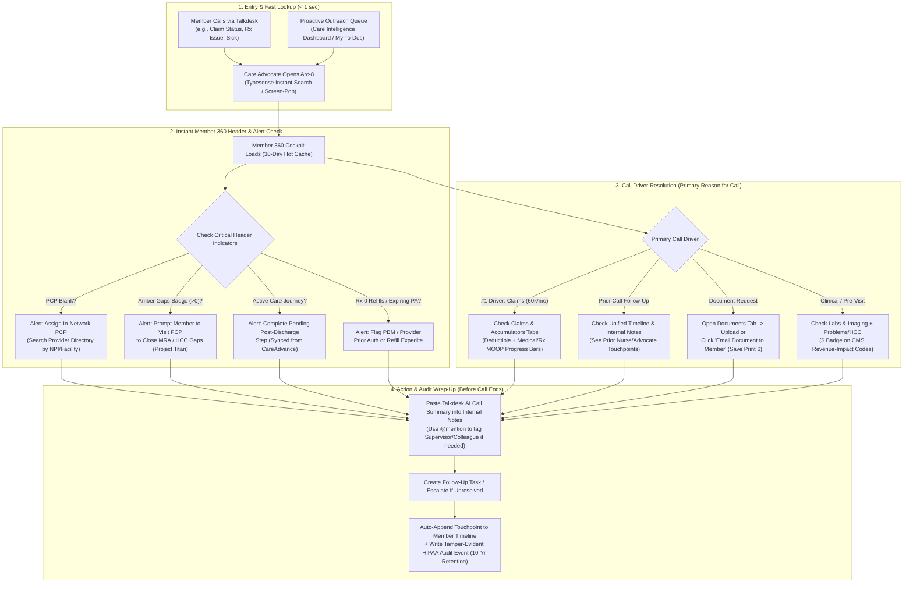
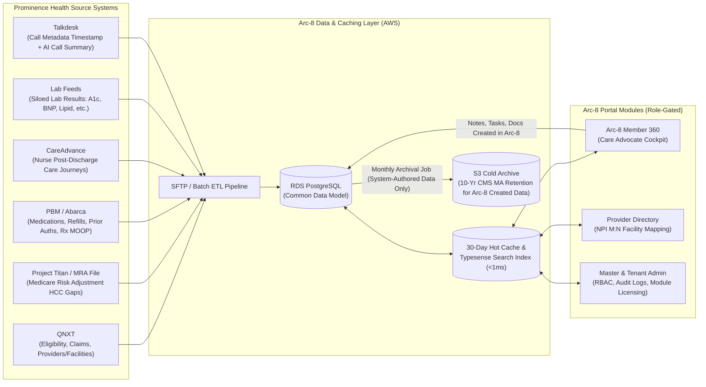

# Proposed System & Operational Workflow — Arc-8 (Prominence Health Member 360)

**Source:** Client System Walkthrough Video (`MicrosoftTeams-video.mp4` — 58m 39s, October 15, 2026)  
**Client & Project Leadership:** Daniel Silva (Prominence Health), Wayne White (Project Lead)  
**Engineering Team:** Syed Sana Ul Haq Fazli (Architecture & Full-Stack Lead), Ramesh Muralasetty (Data Lead), Shaheer Sarwar (Sr. DevOps Lead), Shahzad Sultan (Sr. QA Engineer), Ahsan Nawaz  
**Status:** Proposed & Aligned with Client Walkthrough  

---

## 1. Executive Summary: Core Business Problem & Strategic Vision

From Daniel Silva's 58-minute live system walkthrough, **Arc-8** (rebranded from `Nexora Lab Member 360`) is positioned as the **NOC / Command Center ("Single Pane of Glass")** for Prominence Health's **Care Advocates (Call Center Team — Jimmy's team)**, **Care Coordinators**, and **Operations/Supervisors**.

### Why Prominence Health Needs This Workflow Urgently
1. **Disconnected Call Center Experience (Talkdesk + QNXT Gap):** When a sick or elderly member calls Prominence Health via **Talkdesk** and speaks to a nurse or Care Advocate, and then calls back an hour later with a follow-up question, the next Care Advocate has **zero visibility** into the prior conversation. Today, agents must search **QNXT** (a read-only claims adjudication system that only shows yesterday's batch data) and spend ~15 minutes hunting down who spoke to the member.
2. **Missed Clinical & Revenue Opportunities on Inbound Calls:** Getting elderly Medicare Advantage members into a doctor's office is one of the hardest challenges in health insurance. Every inbound call (e.g., **60,000 calls/month expected in January just for claim status**) is a critical opportunity to see **Missing PCP**, **Open Care/HCC Gaps (Project Titan)**, or **Expiring Medication Prior Authorizations / 0 Refills** and act on them before the member hangs up.
3. **Offloading High-Cost Nursing Staff (CareAdvance Integration):** Nurses are the highest-cost resource in the organization. By syncing post-discharge **Care Journeys** from **CareAdvance** into Arc-8, Care Advocates on the phone can complete routine post-discharge follow-up steps (`Discharge intake`, `Medication reconciliation`, `Cardiology follow-up`, `30-day outcome`) instead of expensive nurses making every call.
4. **CMS Star Ratings & CAHPS Recovery (Pharmacy/PBM):** Pharmacy friction (handled externally via PBM **Abarca**, e.g., expired Prior Authorizations or `0 refills` on insulin) was a top driver of Prominence losing a full CMS Star Rating and taking CAHPS hits.
5. **Eliminating $1M/Year Printing Costs & Legacy File Share Debt:** Prominence spends **$1,000,000/year printing documents** (HRAs, Patient Care Forms, Invoices, EOBs) and relies on an un-refactorable legacy file share ("dumpster fire"). Arc-8 will store member-scoped documents in HIPAA-compliant cloud storage with a **1-click "Email Document to Member"** workflow.

---

## 2. End-to-End Proposed Operational Workflow (Care Advocate Call Lifecycle)

---

## 3. Source System & Data Ingestion Workflow Architecture

### Key Data Engineering Rules Established in the Meeting
1. **Provider $\leftrightarrow$ Facility Many-to-Many ($M:N$) Relationship:**
   - A single medical doctor (synced by **NPI**) can practice at multiple contracted facilities (e.g., *New Jersey Medical Center* and *New Jersey Behavioral Health Center*), and a single facility has many doctors.
   - Claims carry the specific facility where the service was billed. Both the Data Model and Provider Directory UI must support this $M:N$ relationship.
2. **30-Day Hot Cache + Typesense Search:**
   - Members with open care gaps often receive/make multiple calls within a month. Everything active within the **last 30 days** must be cached in a fast hot layer (with **Typesense** indexing for `<1ms` search across millions of records) so Care Advocates experience zero lag or re-fetching.
3. **10-Year CMS Medicare Advantage Retention Policy (Source vs. System-Created Data):**
   - **Source Data (Claims, Eligibility, Labs):** Prominence Health already retains source data in their core systems; Arc-8 does not need to archive source system copies for 10 years.
   - **System-Created Data (Notes, Tasks, Uploaded Documents, Journey Updates):** Anything authored *inside* Arc-8 (e.g., a Care Coordinator note saying *"I talked to Edna"*) is legally **Medicare Advantage data** and **MUST be retained for 10 years** (via monthly timestamped archival jobs to cold S3 storage).

---

## 4. Module-by-Module Proposed Workflow & Changes

### 4.1. Global Branding, Landing & Admin Console
* **Rebrand `Nexora Lab` $\rightarrow$ `Arc-8`:** Global find-and-replace across UI headers and labels (`NexoraLab Member360` becomes `Arc-8`).
* **Two-Tier Admin Architecture:**
  1. **Vendor / Master Admin Console (408 / Platform Owner):** Controls which modules a tenant has purchased (`Member 360`, `Coding Worklists`, `Ride Booking`, etc.) all backed by the same Common Data Model (where Member 360 provides ~90% of the foundational data).
  2. **Tenant Admin Console (Prominence Health Bosses/Admins):** Manages users, roles, and RBAC tab permissions.
* **Landing Page (`Portal Overview`) vs. Direct Member 360 Entry:**
  - Remove the redundant "Member quick search" testing box on `Portal Overview` and remove the redundant `Chart` sub-tab inside Member 360 (since clicking a member from `Members` search opens their chart directly).

### 4.2. Care Intelligence Dashboard ("The NOC / Command Center")
* Acts as the operational command center displaying:
  - **Members in Active Workflows**, **High-Risk Members (C-SNP cohort — definition to be finalized with Prominence)**, **Critical-Risk Members**, **Open/Overdue Tasks**, and **Active Care Journeys**.
  - **My To-Dos / Assigned Tasks:** Care Advocates click a task (e.g., *Post-discharge follow-up*, *HbA1c follow-up due*) and deep-link straight to the member's chart where the action takes place.

### 4.3. Member 360 Header & Alert Bar
* **Keep:** Member Name, Member ID, Plan ID & Plan Name (e.g., *Prominence Health Plus*, *Medicare Advantage*), Age, Gender, **PCP Hyperlink** (links directly to Provider Directory profile), and **Amber `Gaps` Badge** (e.g., `2 gaps`).
* **Add Missing PCP Visual Alert:** If `PCP` is blank/unassigned, surface a high-visibility indicator so the Care Advocate assigns an in-network PCP during the call.
* **Remove (For Now):** **Risk Stratification Score badge** (`complex 2.8`) in the member header—rip out/hide until the external partner (*Virgin*) risk integration is finalized.

### 4.4. Member 360 Sub-Tabs: Proposed Role-Based Grouping & Workflow

| Proposed Tab / Group | Visible To | Functional Workflow & Specific Changes |
| :--- | :--- | :--- |
| **1. `Timeline`** | All Roles | **Chronological Single Source of Truth:** Logs every touchpoint automatically (claims batch ingested, Talkdesk inbound/outbound call timestamp, care plan review, journey stage completed, note added). **Enhancement:** Make every timeline row **clickable** to drill into the underlying claim, note, or task. |
| **2. `Notes`** | All Roles | **Internal Call Documentation:** Simplify channel to **Internal Only** for MVP. Care Advocates paste the **Talkdesk AI Call Summary** or type call notes here so the next agent has full context. **Enhancement:** Add **`@mention` tagging** (e.g., `@Daniel please review`) to notify colleagues/supervisors. |
| **3. `Claims & Accumulators`** *(Grouped)* | All Roles | **#1 Call Driver (60k calls/mo):** Shows claim adjudication status (`Paid`, `Pending`, billed vs. paid vs. member responsibility) alongside the two **Accumulator Progress Bars** (**Deductible** and **Out-of-Pocket Max / MOOP** combining Medical + Pharmacy out-of-pocket spend). |
| **4. `Care Gaps & HCCs`** *(Grouped: `Care Gaps` + `Problems / HCC`)* | All Roles / Coding Team | **Project Titan (MRA Gaps File) Workflow:** `Care Gaps` shows suspected/open HCC gaps requiring a doctor visit. Once diagnosed on a claim, the ICD-10 moves into `Problems / HCC` (active conditions) and closes the gap. **Enhancement:** Display **all diagnoses** in `Problems / HCC`, and add a **`$` / star badge** next to diagnoses that have direct CMS revenue/RAF impact. |
| **5. `Medications`** | All Roles | **PBM (Abarca) & Star Rating Protection:** Displays active/historical prescriptions, last fill date, refills remaining, and prescriber. **Enhancement:** Highlight **0 Refills** or **Expiring Prior Authorizations** (especially critical drugs like insulin) and support cross-communication/alerts to expedite PA/refills before the member is stranded at the pharmacy. |
| **6. `Labs & Imaging`** | All Roles | **Pre-Visit Clinical Readiness:** Surfaces incoming lab results (`HbA1c`, `BNP`, `Creatinine`, `Lipids` with High/Abnormal flags) that are currently siloed in a single internal team at Prominence, allowing advocates and doctors to verify if pre-visit labs were completed. |
| **7. `Care Journey`** | All Roles (Nurses & Advocates) | **CareAdvance Post-Discharge Sync:** Syncs post-discharge pathways created by nurses in **CareAdvance** (`Discharge intake`, `Medication reconciliation`, `Cardiology follow-up`, `30-day outcome`) plus SBAR workspace tasks (`Situation`, `Background`, `Assessment`, `Recommendation`). Advocates can click `Start` / `Complete` on stages during routine calls. |
| **8. `Documents`** | All Roles | **Paperless Member Document Repository:** Replaces the legacy file share and cuts the $1M/year printing spend. Stores HRAs, Patient Care Forms, Invoices, and Lab PDFs per member. **Enhancement:** Add a **"Send Document to Member" (Email)** button. |
| **9. `Audit Log` & `Sharing` & `Settings`** | **Supervisors / Bosses / Ops / Admins ONLY** | **RBAC-Restricted Admin Views:** Captures granular actor/event telemetry (`member360.member.detail`, `member360.gaps.view`) to prevent IT rabbit holes while hiding it from regular Care Advocates so coworkers don't use it against each other. |
| ~~**`Messages`**~~ | **Hidden (Out of Scope)** | **Comment Out for Year-End MVP:** Embedded Talkdesk live voice/SMS/chat widget is deferred (Talkdesk integration won't happen before year-end; call metadata/summaries will flow via Timeline & Notes instead). |
| ~~**`Portal Preview`**~~ | **Hidden (Dev Artifact)** | **Remove from UI (Keep Code in Repo):** Was only a developer test harness Daniel used to preview a member-facing portal for another prospect. |
| ~~**`Chart`**~~ | **Removed (Redundant)** | **Remove Sub-Tab:** Redundant test tab; users open charts directly from the `Members` search/roster table. |
