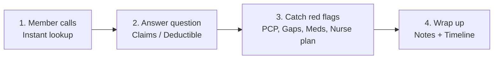
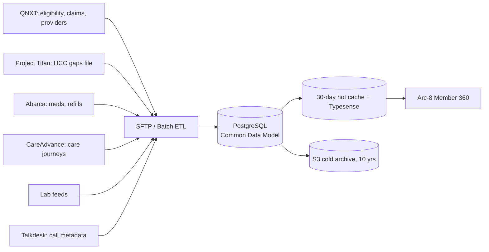

# Arc-8 Member 360 — Team Presentation
*Slide-by-slide outline. Each `##` = one slide. "Say:" = speaker script. "Notebook:" = ideas to expand later.*

---

## Slide 1 — Title
**Arc-8 Member 360: One Screen for the Whole Call Center**
Client: Prominence Health | Based on the 58-min client walkthrough (Daniel Silva)

**Say:** "Today I'll explain what the client showed us, how the system works, and how we can make it better."

---

## Slide 2 — The Problem
- Care Advocates use **5–6 disconnected systems**: QNXT (claims), Abarca (pharmacy), CareAdvance (nurse plans), Talkdesk (calls), old file share (documents)
- Member calls at 10:00, calls back at 11:00 → new agent has **no idea** what was said
- Agents spend ~15 min hunting for data

**Say:** "Agents are flying blind."
**Notebook:** Add a before/after screenshot of agent desktop.

---

## Slide 3 — Why It Matters (Numbers)
| Fact | Number |
|---|---|
| Claim-status calls expected from January | **60,000 / month** |
| Printing cost per year | **$1,000,000** |
| Medicare Advantage data retention | **10 years** |
| Biggest cost to reduce | Nurse time |
| Past damage | Lost a CMS Star rating (pharmacy issues) |

---

## Slide 4 — The Solution in One Sentence
> **Arc-8 pulls ~90% of member data onto ONE screen, in under 1 second, so every call solves the problem AND catches clinical/revenue gaps.**

---

## Slide 5 — The 4-Step Call Workflow

---

## Slide 6 — Step 1 & 2: Lookup and Answer
- Search by name/ID → full chart opens instantly (cached)
- **Claims tab**: Paid / Pending, billed vs paid vs member cost
- **Accumulators**: Deductible + Max Out-of-Pocket progress bars
- **Documents**: send forms by email instead of paper

---

## Slide 7 — Step 3: The 4 Red Flags (Real Value)
| Red Flag | Agent says | Business win |
|---|---|---|
| No PCP assigned | "Let's pick a doctor now" | Gaps can only close via a doctor |
| Open Care Gaps (`2 gaps`) | "Did you see Dr. Nguyen about…?" | CMS revenue (Project Titan / MRA file) |
| Rx 0 refills / expiring Prior Auth | "I'll flag your insulin now" | Protects Star rating / CAHPS |
| Nurse post-discharge checklist | Agent checks off steps | Saves expensive nurse time |

---

## Slide 8 — Step 4: Wrap Up
- Paste Talkdesk AI call summary into **Notes**
- `@mention` a colleague/supervisor
- Auto-logged on **Timeline** → next agent sees everything
- Notes kept **10 years** (Medicare law)

---

## Slide 9 — Where the Data Comes From

**Key rule:** Provider ↔ Facility is **many-to-many** (matched by NPI).

---

## Slide 10 — What the Client Wants Changed (Decisions Made)
| Item | Decision |
|---|---|
| 15 tabs with scrollbar | Group into ~8 role-based tabs |
| Audit Log, Sharing, Settings | Supervisors/Admins only |
| Messages (Talkdesk widget) | Out of scope for year-end |
| Portal Preview, Chart tab | Remove from UI (keep code) |
| Header risk score | Hide until Virgin integration |
| Diagnoses | Show all, mark revenue-impact with `$` |
| Notes | Internal only + `@mention` |

---

## Slide 11 — Our 6 Proposed Enhancements
1. **Clean role-based UI** — 7–8 tabs, no scrollbar
2. **Call-time alert bar** — No PCP, 0-refill Rx, `$` revenue badge
3. **Clickable Timeline + @mentions**
4. **1-click "Email document to member"** — attacks $1M printing cost
5. **Typesense + 30-day Redis cache** — sub-second search at 60k calls/month
6. **Auto 10-year archiver** — monthly job to S3 cold storage

---

## Slide 12 — Roadmap
| Sprint | Focus |
|---|---|
| Sprint 1 (Oct 19–30) | AWS Dev, Cognito/RBAC, Azure decoupling, Alembic tables |
| Sprint 2 | Search, Member 360 profile, UI tab cleanup |
| Sprint 3 | Risk, Care Journeys (CareAdvance), alert bar |
| Sprint 4 | Tasks, notes/@mention, audit, dashboard, docs email |

---

## Slide 13 — Risks & Open Questions
- Need SFTP access + sample DDL/DML from Daniel (Ramesh)
- CareAdvance / PBM data formats unknown → SME sessions next week
- C-SNP "high risk" definition not final
- Talkdesk long-term (≈$1M/yr) may change
- **Strict PHI isolation** — one user must never see another tenant/user data

---

## Slide 14 — Next Steps
1. Get SFTP + schemas → finalize data model
2. Implement tab grouping + RBAC gating
3. Add Typesense/cache + archiver design
4. Meet Rabeel, Jimmy, Pat, nurses, SMEs (Monday follow-up)

---

## Slide 15 — Closing Line
> "Member 360 is the foundation. Every future module — Coding Worklist, Ride Booking — plugs into the same data."

---

## Notebook Ideas (to expand)
- Screenshots from the video for each tab
- Demo persona: "Kiana Martinez" call walkthrough
- ROI estimate: printing savings, nurse hours saved, Star-rating impact
- Competitor comparison of agent desktops
- Q&A cheat sheet for partners
