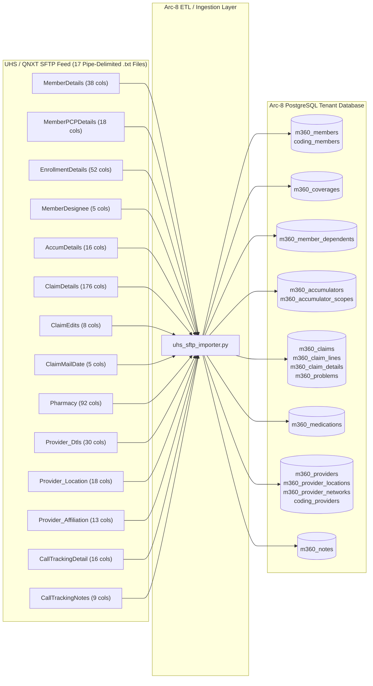

# UHS / Prominence SFTP to Arc-8 PostgreSQL Data Mapping Specification

**Prepared For:** Data Management & Database Architecture Team  
**Application:** Arc-8 Member 360 & Care Orchestration Platform (`oeight` / `arc8`)  
**Source System:** Prominence Health / UHS QNXT Pipe-Delimited (`|`) SFTP Extracts (`17 Files`)  
**Target Database:** Amazon RDS PostgreSQL — Tenant Schema (`m360_*` & `coding_*` tables)  
**Date:** November 12, 2026

---

## 1. Executive Summary & Architectural Overview

The UHS SFTP feed consists of **17 pipe-delimited (`|`) flat text files** exported from Prominence Health's **QNXT** core administration system (`PHP_To_OEight_*` and `PHP_CallTracking*`).

Because QNXT exports wide, denormalized flat files (for example, `ClaimDetails` contains **176 columns** on a single line including `DiagCode1` through `DiagCode40`), while Arc-8 uses normalized PostgreSQL tables ([member360.py](file:///D:/OnStak-Projects/Arc-8/backend/app/models/member360.py) and [coding.py](file:///D:/OnStak-Projects/Arc-8/backend/app/models/coding.py)), the import pipeline ([uhs_sftp_importer.py](file:///D:/OnStak-Projects/Arc-8/backend/app/services/uhs_sftp_importer.py)) performs **schema translation, normalization, and idempotent upserts**.

---

## 2. Master File Inventory & Target Table Summary

| Load Order | UHS SFTP Source File | Total Cols | Target PostgreSQL Table(s) | Natural / Upsert Key | Mapping Status |
| :---: | :--- | :---: | :--- | :--- | :--- |
| **1** | `PHP_To_OEight_Provider_Dtls_QNXT_*.txt` | 30 | `m360_providers`, `coding_providers` | `npi` (`NationalProviderID`) | Mapped |
| **2** | `PHP_To_OEight_Provider_Location_QNXT_*.txt` | 18 | `m360_provider_locations` | `provider_id` + address | Mapped |
| **3** | `PHP_To_OEight_Provider_Affiliation_QNXT_*.txt` | 13 | `m360_provider_networks` | `provider_id` + `plan_name` | Mapped |
| **4** | `PHP_To_OEight_Provider_PayTo_QNXT_*.txt` | 20 | `m360_provider_payto` | `vendor_id` (`VendorID`) | Mapped |
| **5** | `PHP_To_OEight_GroupDetails_*.txt` | 30 | `m360_employer_groups` | `group_number` (`GROUP_NUMBER`) | Mapped |
| **6** | `PHP_To_OEight_BorkerDetails_*.txt` | 5 | `m360_brokers` | `broker_id` + `group_number` | Mapped |
| **7** | `PHP_To_OEight_MemberDetails_*.txt` | 38 | `m360_members`, `coding_members`, `m360_external_key_maps` | `member_key` (`MemberID`) | Mapped |
| **8** | `PHP_To_OEight_EnrollmentDetails_*.txt` | 52 | `m360_coverages`, `m360_members` | `member_id` + `effective_date` | Mapped |
| **9** | `PHP_To_OEight_MemberPCPDetails_*.txt` | 18 | `m360_members`, `coding_members` | `member_key` (`MemberID`) | Mapped |
| **10** | `PHP_To_OEight_MemberDesignee_*.txt` | 5 | `m360_member_dependents` | `subscriber_member_id` + `member_key` | Mapped |
| **11** | `PHP_To_OEight_AccumDetails_*.txt` | 16 | `m360_accumulators`, `m360_accumulator_scopes` | `member_id` + `scope` | Mapped (Pivoted by `DED`/`OOP`) |
| **12** | `PHP_To_OEight_ClaimDetails_*.txt` | 176 | `m360_claims`, `m360_claim_lines`, `m360_problems` | `claim_number` + `line_number` | Mapped (Unpivots `DiagCode1..40`) |
| **13** | `PHP_To_OEight_ClaimEdits_*.txt` | 8 | `m360_claim_details`, `m360_claim_lines` | `claim_id` (`claimid`) | Mapped |
| **14** | `PHP_To_OEight_ClaimMailDate_*.txt` | 5 | `m360_claim_details` | `claim_id` (`claimid`) | Mapped |
| **15** | `PHP_To_OEight_Pharmacy_*.txt` | 92 | `m360_medications` | `member_id` + `rx_number` | Mapped |
| **16** | `PHP_CallTrackingDetail_*.txt` | 16 | `m360_notes` | `callerid` prefix in `body` | Mapped |
| **17** | `PHP_CallTrackingNotes_*.txt` | 9 | `m360_notes` | `callerid` + `Number` sequence | Mapped (Appended to Call Detail) |

---

## 3. Detailed Field-to-Field Mapping by File

### 3.1 Member Demographics: `PHP_To_OEight_MemberDetails_*.txt` (38 Columns)
**Target Tables:** `m360_members` (Primary) and `coding_members` (Secondary)

| Col # | UHS SFTP Field Name | Target Arc-8 Table | Target Arc-8 Column | Target Type | Transformation / Import Rule |
| :---: | :--- | :--- | :--- | :--- | :--- |
| 1 | `InternalMemberID` | `m360_members` | `member_key` (fallback) | `String(64)` | Used if `MemberID` is blank (`QEMEM...`) |
| 2 | `MemberID` | `m360_members` `coding_members` | `member_key` `member_key` | `String(64)` | **Primary Natural Key** for member lookup/upsert |
| 3 | `HIC#` | *(Unmapped)* | — | — | Medicare HIC/MBI; not currently stored on `m360_members` |
| 4 | `Title` | *(Unmapped)* | — | — | Salutation prefix |
| 5 | `MemberStatus` | `coding_members` | `status` | `String(32)` | Directly mapped (`Active`, `Termed`) |
| 6 | `FirstName` | `m360_members` `coding_members` | `first_name` `first_name` | `String(80)` | Title-cased (`first_name.title()`) |
| 7 | `LastName` | `m360_members` `coding_members` | `last_name` `last_name` | `String(80)` | Title-cased (`last_name.title()`) |
| 8 | `MiddleName` | *(Unmapped)* | — | — | Optional middle initial |
| 9 | `PhyAddrLine1` | `m360_members` | `address_line1` | `String(160)` | Falls back to `MailingAddrLine1` if empty |
| 10 | `PhyAddrLine2` | *(Unmapped)* | — | — | Can be concatenated to `address_line1` if needed |
| 11 | `PhyAddrCity` | `m360_members` `coding_members` | `address_city` `address_city` | `String(64)` | Falls back to `MailingCity` if empty |
| 12 | `PhyAddrState` | `m360_members` `coding_members` | `address_state` `address_state` | `String(2)` | 2-letter state code (e.g., `NV`) |
| 13 | `PhyAddrZip` | `m360_members` `coding_members` | `address_zip` `address_zip` | `String(10)` | Truncated/normalized to 10 chars |
| 14 | `PhyAddrCounty` | *(Unmapped)* | — | — | County name (e.g., `WASHOE`) |
| 15 | `Gender` | `m360_members` `coding_members` | `gender` `gender` | `String(16)` / `String(1)` | `F` / `M` / `U` |
| 16 | `DOB` | `m360_members` `coding_members` | `date_of_birth` `date_of_birth` | `Date` | Parsed from `YYYY-MM-DD` |
| 17–19 | `HomePhone#`, `Fax`, `MobilePhone`, `WorkPhone` | `m360_members` | `phone` | `String(32)` | Coalesces `HomePhone#` $\rightarrow$ `MobilePhone` $\rightarrow$ `WorkPhone` |
| 21 | `EmailAddress` | `m360_members` | `email` | `String(255)` | Trimmed string |
| 22–26 | `MailingAddrLine1..MailingZip` | `m360_members` | `address_*` | `String` | Used as fallback when physical address is blank |
| 27–29 | `EnrollType`, `RaceCode`, `RaceDescription` | *(Unmapped)* | — | — | Demographic metadata |
| 30 | `PrimaryLanguage` | `m360_members` `coding_members` | `preferred_language` `primary_language` | `String(48)` | Title-cased (`English`, `Spanish`) |
| 31–35 | `WrittenLanguage`, `SSN`, `EmergencyContactName`, `EmergencyPrimaryPhone`, `DeathDate` | *(Unmapped)* | — | — | `SSN` is empty in UHS feed; `DeathDate` can be added if needed |
| 36 | `LOB` | `m360_members` `coding_members` | `line_of_business` `line_of_business` | `String(64)` | e.g., `Commercial`, `Medicare Advantage`, `Medicaid` |
| 37–38 | `ConfidentialMemberFlag`, `ElectronicOptInFlag` | *(Unmapped)* | — | — | Privacy/communication flags |

---

### 3.2 Eligibility & Coverage Spans: `PHP_To_OEight_EnrollmentDetails_*.txt` (52 Columns)
**Target Tables:** `m360_coverages` (Inserts/Updates span) and `m360_members` (Updates active `plan_name` & `line_of_business`)

| Col # | UHS SFTP Field Name | Target Arc-8 Table | Target Arc-8 Column | Target Type | Transformation / Import Rule |
| :---: | :--- | :--- | :--- | :--- | :--- |
| 1 | `EnrollID` | *(Lookup / Audit)* | — | — | QNXT Enrollment Span ID (`ES...`) |
| 2 | `SpanType` | `m360_coverages` | `coverage_status` | `String(32)` | If contains `Del` or `Void` $\rightarrow$ `'termed'`, else `'active'` |
| 3 | `MemberID` | `m360_coverages` | `member_id` (FK) | `Integer` | Resolved via `m360_members.member_key == MemberID` |
| 4 | `SubscriberMemberID` | `m360_coverages` | `relationship_to_subscriber` | `String(32)` | `'subscriber'` if `MemberID == SubscriberMemberID` else `'dependent'` |
| 8 | `EnrollmentEffDate` | `m360_coverages` | `effective_date` | `Date` | Parsed `YYYY-MM-DD` (falls back to `EnrollCovTypeEffDate`) |
| 9 | `EnrollmentTermDate` | `m360_coverages` | `term_date` | `Date` | Parsed `YYYY-MM-DD` (falls back to `EnrollCovTypeTermDate`) |
| 25 | `ProgramName` | `m360_coverages` `m360_members` | `plan_name` `plan_name` | `String(128)` | e.g., `HEALTHFIRST HMO` (falls back to `PlanID`) |
| 27 | `InternalMemberID` | `m360_coverages` | `member_id` (FK fallback) | `Integer` | Fallback lookup key if `MemberID` is blank |
| 35 | `ProductType` | `m360_coverages` | `coverage_tier` | `String(32)` | e.g., `HMO`, `PPO`, `POS` |
| 47 | `PrimaryOrSecondaryCovType` | `m360_coverages` | `is_primary` | `Boolean` | `False` if contains `'sec'`, else `True` |
| 48 | `LOB` | `m360_coverages` `m360_members` | `line_of_business` `line_of_business` | `String(64)` | e.g., `Commercial`, `Medicare Advantage` |

*(Remaining QNXT rating area, premium amount, and HIOS columns `RxPremAmount`, `MedicalPremAmount`, `HIOSPlanId`, etc. are financial/underwriting fields not displayed in Member 360.)*

---

### 3.3 Member PCP Assignments: `PHP_To_OEight_MemberPCPDetails_*.txt` (18 Columns)
**Target Tables:** `m360_members` and `coding_members`

| Col # | UHS SFTP Field Name | Target Arc-8 Table | Target Arc-8 Column | Target Type | Transformation / Import Rule |
| :---: | :--- | :--- | :--- | :--- | :--- |
| 5 | `MemberID` | `m360_members` | `member_key` (lookup) | `String(64)` | Resolves target member row |
| 9 | `PCPNPI` | `coding_members` | `pcp_npi` | `String(15)` | 10-digit Provider NPI |
| 13 | `ProviderGroupName` | `m360_members` | `primary_care_provider` (fallback) | `String(128)` | Used if individual physician name is blank |
| 15–16 | `PCPFirstName` + `PCPLastName` | `m360_members` `coding_members` | `primary_care_provider` `pcp_name` | `String(128)` | Formatted as `"Dr. {PCPFirstName} {PCPLastName}"` |

---

### 3.4 Member Representatives / Dependents: `PHP_To_OEight_MemberDesignee_*.txt` (5 Columns)
**Target Table:** `m360_member_dependents`

| Col # | UHS SFTP Field Name | Target Arc-8 Table | Target Arc-8 Column | Target Type | Transformation / Import Rule |
| :---: | :--- | :--- | :--- | :--- | :--- |
| 1 | `membermemid` | `m360_member_dependents` | `subscriber_member_id` (FK) | `Integer` | Looks up `m360_members.id` by `member_key` |
| 2 | `designeememid` | `m360_member_dependents` | `member_key` | `String(64)` | Designee's member identifier |
| 3–4 | `effdate`, `termdate` | `m360_member_dependents` | `coverage_status` | `String(32)` | Active/Termed status check |
| 5 | `designeetypedesc` | `m360_member_dependents` | `relationship_type` | `String(32)` | e.g., `FAMILY REPRESENTATIVE` |

---

### 3.5 Benefit Accumulators (Deductible & OOP): `PHP_To_OEight_AccumDetails_*.txt` (16 Columns)
**Target Tables:** `m360_accumulators` (1:1 summary) and `m360_accumulator_scopes` (`individual` vs. `family`)

> [!IMPORTANT]
> **Row-to-Column Pivot Logic:** In UHS's feed, Deductible (`SpecificType = 'DED'`) and Out-of-Pocket Max (`SpecificType = 'OOP'`) arrive as **separate rows** for the same member. The importer pivots these rows into the `deductible*` and `out_of_pocket*` columns on `m360_accumulators` and `m360_accumulator_scopes`.

| Col # | UHS SFTP Field Name | Target Arc-8 Table | Target Arc-8 Column | Target Type | Transformation / Import Rule |
| :---: | :--- | :--- | :--- | :--- | :--- |
| 2 | `MemberID` (or `AltMemberID`) | `m360_accumulators` `m360_accumulator_scopes` | `member_id` (FK) | `Integer` | Resolves `m360_members.id` |
| 8 | `SpecificType` | *(Pivot Discriminator)* | — | — | `'DED'` routes amounts to Deductible columns; `'OOP'`/`'MOOP'` routes to Out-of-Pocket columns |
| 9 | `CurrentAmount` | `m360_accumulators` `m360_accumulator_scopes` | `deductible_met` *or* `out_of_pocket_met` | `Numeric(12,2)` | Based on `SpecificType` (`DED` vs `OOP`) |
| 10 | `MaximumAmount` | `m360_accumulators` `m360_accumulator_scopes` | `deductible` *or* `out_of_pocket_max` | `Numeric(12,2)` | Based on `SpecificType` (`DED` vs `OOP`) |
| 12 | `IndividualAccum` | `m360_accumulator_scopes` | `scope` | `String(16)` | `'1'`/`'Y'` $\rightarrow$ `'individual'`, else `'family'` |
| 15 | `PlanYear` | `m360_accumulators` `m360_accumulator_scopes` | `plan_year_start` | `Date` | Converted to `YYYY-01-01` (e.g., `2026-01-01`) |

---

### 3.6 Medical Claims & Clinical Diagnoses: `PHP_To_OEight_ClaimDetails_*.txt` (176 Columns)
**Target Tables:** `m360_claims` (Header), `m360_claim_lines` (Service Lines), and `m360_problems` (ICD-10 Diagnoses)

| Col # | UHS SFTP Field Name | Target Arc-8 Table | Target Arc-8 Column | Target Type | Transformation / Import Rule |
| :---: | :--- | :--- | :--- | :--- | :--- |
| 2 | `claimid` | `m360_claims` | `claim_number` | `String(64)` | Natural key (`member_id` + `claim_number`) |
| 3 | `claimline` | `m360_claim_lines` | `line_number` | `Integer` | Service line number (`1, 2, ...`) |
| 4 | `ClaimStatus` | `m360_claims` | `status` | `String(32)` | Lowercased (`paid`, `denied`, `pended`) |
| 5 | `ClaimLineStatus` | `m360_claim_lines` | `status` | `String(32)` | Lowercased line status |
| 13 | `RenderingProvider` | `m360_claims` `m360_problems` | `provider` `recorded_by` | `String(160)` | Falls back to `PayToFacilityName` |
| 18 | `RenderingProviderSpecDesc` | `m360_claim_lines` | `procedure_description` | `String(255)` | Falls back to `PosDesc` |
| 31 | `memid` | `m360_claims` | `member_id` (FK) | `Integer` | Resolves `m360_members.id` (fallback: `InternalSubscriberID`) |
| 39 | `ClaimType` | `m360_claims` | `category` | `String(64)` | e.g., `Professional`, `Institutional` |
| 43 | `StartServiceDate` | `m360_claims` `m360_claim_lines` `m360_problems` | `service_date` `service_date` `onset_date` | `Date` | Falls back to `DOSFrom_ClaimLine` |
| 74–77 | `servcode`, `Cpt41`, `Hcpcs` | `m360_claim_lines` | `procedure_code` | `String(32)` | Coalesces `Cpt41` $\rightarrow$ `Hcpcs` $\rightarrow$ `servcode` |
| 86–127 | `PrinDiag`, `AdmitDiag`, `DiagCode1`..`DiagCode40` | `m360_problems` | `code` (`code_system='ICD-10'`) | `String(32)` | **Unpivoted:** Every non-empty diagnosis code creates/updates an active problem row on `m360_problems` (`is_primary=True` for `PrinDiag`) |
| 133 | `amountpaid` | `m360_claims` `m360_claim_lines` | `paid_amount` `paid_amount` | `Numeric(12,2)` | Decimal currency |
| 139 | `claimamt_or_Charges` | `m360_claims` `m360_claim_lines` | `billed_amount` `billed_amount` | `Numeric(12,2)` | Decimal currency |
| 140 | `AllowedAmt_or_ContractPaid` | `m360_claim_lines` | `allowed_amount` | `Numeric(12,2)` | Decimal currency |
| 141 | `coinsuranceamt` | `m360_claim_lines` | `coinsurance` | `Numeric(12,2)` | Decimal currency |
| 142 | `memamt` | `m360_claims` `m360_claim_lines` | `member_responsibility` `member_responsibility` | `Numeric(12,2)` | Total patient responsibility |
| 143 | `copay` | `m360_claim_lines` | `copay` | `Numeric(12,2)` | Decimal currency |
| 144 | `Deductible` | `m360_claim_lines` | `deductible` | `Numeric(12,2)` | Decimal currency |
| 174 | `LineLevelPendRuleDescription` | `m360_claim_lines` | `denial_reason` | `String(255)` | Line-level pend/denial message |

---

### 3.7 Claim Adjudication Edits & Remittance Dates: `ClaimEdits` (8 Cols) & `ClaimMailDate` (5 Cols)
**Target Table:** `m360_claim_details`

| Source File | UHS SFTP Field Name | Target Arc-8 Table | Target Arc-8 Column | Target Type | Transformation / Import Rule |
| :--- | :--- | :--- | :--- | :--- | :--- |
| `ClaimEdits` | `claimid` | `m360_claim_details` | `claim_id` (FK) | `Integer` | Looks up `m360_claims.id` by `claim_number` |
| `ClaimEdits` | `RemitDescription` / `ClaimEditDescription` | `m360_claim_details` | `denial_reason` | `Text` | Coalesces `RemitDescription` $\rightarrow$ `ClaimEditDescription` |
| `ClaimMailDate` | `claimid` | `m360_claim_details` | `claim_id` (FK) | `Integer` | Looks up `m360_claims.id` by `claim_number` |
| `ClaimMailDate` | `MailDate` | `m360_claim_details` | `remittance_date` | `Date` | EOB / check mail date |

---

### 3.8 Pharmacy / Prescription Claims: `PHP_To_OEight_Pharmacy_*.txt` (92 Columns)
**Target Table:** `m360_medications`

| Col # | UHS SFTP Field Name | Target Arc-8 Table | Target Arc-8 Column | Target Type | Transformation / Import Rule |
| :---: | :--- | :--- | :--- | :--- | :--- |
| 2 | `MemberID` | `m360_medications` | `member_id` (FK) | `Integer` | Resolves `m360_members.id` |
| 8 | `PrescriptionNumber` | `m360_medications` | `rx_number` | `String(64)` | **Natural Key** within member (falls back to `ClaimNumber`) |
| 9 | `DateRxWritten` | `m360_medications` | `start_date` | `Date` | Date prescription was written |
| 11 | `DateofService` | `m360_medications` | `last_fill_date` | `Date` | Dispense / fill date |
| 12 | `NDCNUmber` | `m360_medications` | `ndc_code` | `String(16)` | 11-digit National Drug Code |
| 13 | `DrugDescription` | `m360_medications` | `drug_name` | `String(255)` | Brand/dispensed drug name + strength |
| 14 | `DrugDescriptionGenericName` | `m360_medications` | `generic_name` | `String(255)` | Generic chemical name |
| 16 | `DaysSupply` | `m360_medications` | `days_supply` | `Integer` | Integer days supply (e.g., `30`, `90`) |
| 29 | `PharmacyName` | `m360_medications` | `pharmacy` | `String(160)` | Dispensing pharmacy name |
| 42–44 | `PrescriberFirstName` + `PrescriberLastName` | `m360_medications` | `prescriber` | `String(160)` | Formatted full name (falls back to `PrescriberIdentification` NPI) |
| 59 | `RouteDescription` | `m360_medications` | `route` | `String(32)` | e.g., `ORAL` |
| 60 | `Strength` | `m360_medications` | `dose` | `String(64)` | e.g., `10 MG` |

---

### 3.9 Provider Directory Feeds: `Provider_Dtls` (30 Cols), `Provider_Location` (18 Cols), `Provider_Affiliation` (13 Cols)
**Target Tables:** `m360_providers`, `m360_provider_locations`, `m360_provider_networks`, and `coding_providers`

| Source File | UHS SFTP Field Name | Target Arc-8 Table | Target Arc-8 Column | Target Type | Transformation / Import Rule |
| :--- | :--- | :--- | :--- | :--- | :--- |
| `Provider_Dtls` | `NationalProviderID` (fallback `ProviderID`) | `m360_providers` `coding_providers` | `npi` `npi` | `String(15)` | **Unique Natural Key** for provider |
| `Provider_Dtls` | `FirstName`, `LastName`, `ProviderDegree`, `OrgName` | `m360_providers` `coding_providers` | `name` `name` | `String(160)` | `"FirstName LastName, Degree"` or `OrgName` |
| `Provider_Dtls` | `TaxID` | `coding_providers` | `tax_id` | `String(15)` | Federal Tax ID / EIN |
| `Provider_Dtls` | `ProviderSpecialty1_Desc` | `m360_providers` | `specialty` | `String(120)` | Primary specialty description |
| `Provider_Dtls` | `Gender` | `m360_providers` | `gender` | `String(16)` | Provider gender |
| `Provider_Dtls` | `IsSpecialtyPCP1` | `m360_providers` | `is_pcp` | `Boolean` | `'True'`/`'1'` $\rightarrow$ `True` |
| `Provider_Location` | `ProviderID` / `ProviderLastName` | `m360_provider_locations` | `provider_id` (FK) | `Integer` | Resolves `m360_providers.id` |
| `Provider_Location` | `LocationAddr1`, `LocationAddr2` | `m360_provider_locations` | `address_line1`, `address_line2` | `String(160)` | Practice street address |
| `Provider_Location` | `LocationAddrCity`, `State`, `Zip` | `m360_provider_locations` | `city`, `state`, `postal_code` | `String` | City, 2-char State, ZIP |
| `Provider_Location` | `LocationPhoneNumber` | `m360_provider_locations` | `phone` | `String(32)` | Location phone |
| `Provider_Affiliation` | `ProviderID` | `m360_provider_networks` | `provider_id` (FK) | `Integer` | Resolves `m360_providers.id` |
| `Provider_Affiliation` | `Program` / `GroupName` | `m360_provider_networks` | `plan_name` | `String(128)` | Network program / group name |
| `Provider_Affiliation` | `LOB` | `m360_provider_networks` | `line_of_business` | `String(64)` | Line of business |
| `Provider_Affiliation` | `ParorNonPar` | `m360_provider_networks` | `network_status` | `String(24)` | `'Par'` $\rightarrow$ `'in_network'`, else `'out_of_network'` |

---

### 3.10 Call Center Logs: `PHP_CallTrackingDetail_*.txt` (16 Cols) & `PHP_CallTrackingNotes_*.txt` (9 Cols)
**Target Table:** `m360_notes`

| Source File | UHS SFTP Field Name | Target Arc-8 Table | Target Arc-8 Column | Target Type | Transformation / Import Rule |
| :--- | :--- | :--- | :--- | :--- | :--- |
| `CallTrackingDetail` | `MemID` | `m360_notes` | `member_id` (FK) | `Integer` | Resolves `m360_members.id` |
| `CallTrackingDetail` | `createid` | `m360_notes` | `author_name` / `author_email` | `String(255)` | Agent ID |
| `CallTrackingDetail` | `calltype_category` + `calltype_description` | `m360_notes` | `note_type` | `String(64)` | e.g., `ENROLLMENT: PCP CHANGE` (`channel='phone'`) |
| `CallTrackingDetail` | `callerid` + `resolution_description` | `m360_notes` | `body` (Header line) | `Text` | Prefixed with `[callerid]` so `CallTrackingNotes` can attach to it |
| `CallTrackingDetail` | `createdate` | `m360_notes` | `created_at` | `DateTime` | Call timestamp |
| `CallTrackingNotes` | `callerid` | `m360_notes` | *(Lookup key)* | — | Matches existing `m360_notes` row starting with `[callerid]` |
| `CallTrackingNotes` | `Number` + `Item` | `m360_notes` | `body` (Appended lines) | `Text` | Sorted by line sequence `Number` and joined with newlines |

---

## 4. Recommendations & Decisions for the Data Manager

1. **Three Administrative / Commercial Reference Files (`GroupDetails`, `BorkerDetails`, `Provider_PayTo`):**
   * Currently, Arc-8's Member 360 care management schema (`m360_*`) does not require separate tables for employer group contacts, insurance brokers, or 1099 vendor tax pay-to records.
   * **Recommendation:** If these 3 files are needed for the **Commercial Finance Payer View** console, we can add 3 lightweight staging tables (`m360_employer_groups`, `m360_brokers`, `m360_provider_payto`) in `member360.py`.
2. **Linking `InternalMemberID` (`QEMEM...`) vs. `MemberID` (`0000...`):**
   * `PHP_To_OEight_MemberDetails` uses `MemberID` (`0000...`) as the external card ID and `InternalMemberID` (`QEMEM...`) as QNXT's internal key, whereas `PHP_CallTrackingDetail` uses `QEMEM...` in `MemID`.
   * **Recommendation:** Add an indexed `external_alt_id: String(64)` column on `m360_members` (or store `InternalMemberID` in a lookup map during batch import) so records referencing `QEMEM...` always join to the exact same `m360_members` record as `MemberID`.
3. **Provider `ProviderID` (`PR000...`) vs. `NationalProviderID` (10-digit NPI):**
   * `Provider_Location` and `Provider_Affiliation` join on QNXT's `ProviderID` (`PR000...`), while `m360_providers` keys on `npi`.
   * **Recommendation:** Store `ProviderID` (`PR000...`) in a `provider_key` column on `m360_providers` alongside `npi` so location and affiliation feeds join deterministically even when a provider row has no NPI.
